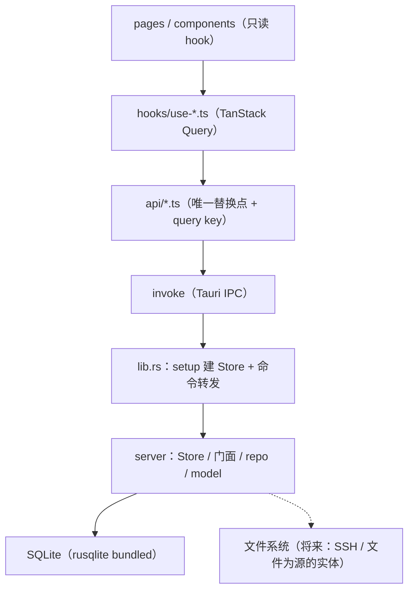

# Lucky-Y 后台架构设计

**作用**：定义桌面端后台的代码分层、目录组织、跨层契约、依赖规则与落地顺序。
表结构归 `design/sql-design/` 管（`全局架构.md` + 各 `*-design/`），本文只管**代码怎么摆、按什么顺序长**。
配图：`后台架构图.html`（分层 / 目录 / 落地顺序）。

**事实源**（本文与代码冲突时以代码为准）：

| 事实源 | 提供什么 |
| --- | --- |
| `src-tauri/src/server/` | 领域层现状：`db.rs` / `error.rs` / `store.rs` / `srv/` |
| `src-tauri/src/lib.rs` | 命令层现状：`setup` 建 Store、17 条命令（`greet` + `srv_*` 16 条）、`ApiError` 转错 |
| `src-tauri/Cargo.toml` | crate 依赖（rusqlite 已并入单 crate） |
| `src/api/*.ts` · `src/hooks/use-*.ts` | 前端数据访问层现状 |
| `design/sql-design/全局架构.md` | 三条建表判据、表归属、迁移约定 |
| `design/sql-design/项目表结构设计.md` | 前端 24 字段 ↔ 表列的逐条结清（项目族与任务的字段依据、表归属） |

---

## 一、分层与依赖方向



依赖必须单向，四条硬线：

| # | 规则 | 校验方式 |
| --- | --- | --- |
| L1 | `#[tauri::command]` 只写在 `src-tauri/src/lib.rs`，命令体 ≤3 行（取 state / 调领域层 / 转错误） | 命令函数里出现 `if`、`match` 业务分支即违规 |
| L2 | 领域层目录（`src-tauri/src/server/`）不出现 `tauri`、`serde_json::Value` 透传；将来加 HTTP 入口时把目录拆回独立 crate，代码零改动 | `grep -r "use tauri" src-tauri/src/server/` 为 0 |
| L3 | `rusqlite` 只被 `src-tauri/src/server/` 内的文件 import，不外溢到命令层 | `grep -rl "rusqlite" src-tauri/src --include="*.rs" | grep -v "/server/"` 为 0 |
| L4 | 组件不 import `api/*`，只 import `hooks/*`；hook 不直接 `invoke` | `grep -rn "invoke(" src/pages src/components` 为 0 |

领域层是 `src-tauri/src/server/` 目录（Tauri v2 官方布局，单 crate），不是独立 crate：
与命令层的边界从编译期保证降为目录纪律，靠上面 L2 / L3 的 grep 校验兜住。将来加 HTTP
入口时把它剪出成 crate，只多一个 `Cargo.toml`，代码不动。

---

## 二、目录组织（单 crate，目录即域）

```text
src-tauri/src/server/
  mod.rs        模块声明 + 重导出
  store.rs      Store：连接 + 锁
  error.rs      Error / Result（全仓一份）
  db.rs         连接参数（foreign_keys / WAL）+ MIGRATIONS
  id.rs         new_id(prefix)——id 生成共用，域前缀参数化（srv- / pj- / tk-）
  project/      执行层「项目」域：project / project_member / project_tag / project_milestone
                / project_document(_link) / project_risk / project_activity
    doc/        文档子域：索引 + 正文文件（`doc/file.rs` 只管文件那一半）
  task/         全局层「任务清单」域：task（未建）
  srv/          跨模块簇：服务器台账（现有 mod.rs / model.rs / repo.rs）
  work/         工作模块专属：work_contact / work_okr / work_time_log …（未建）
```

**判据：目录名 = 功能域名，与该域的表前缀同源**（`project` / `task` / `srv` / `work`）。
project / task 不带表前缀（跨域共用一张表、用 `scope` 隔离），但它们在功能上各有主人
（项目模块 `/projects`、任务清单 `/tasks`），所以**各占一个域目录** —— 不合成一个叫"公共"的目录：
那样会让下一轮改动找不到"这套表该找谁"。

### 为什么按域摆，不按职责摆

后端说的「域」= **表的功能归属域**（项目 / 任务 / 模块专属 / 跨模块簇，见 `design/sql-design/全局架构.md` §六），
它**同时**是代码目录：`project/` 与 `task/` 就是前端「执行层 · 项目」「全局层 · 任务清单」两个分区的后端一半，
`srv/` 则是跨模块簇（不是任何一个页面的私有表）。前端 `pages/` 按域摆、后端按「这张表归谁」摆，两边的域是同一批。

| 摆法 | 得到什么 | 丢掉什么 |
| --- | --- | --- |
| **按域**（`project/` `task/` `srv/` `work/`） | 域边界由 Rust 模块系统强制（`pub` 之外的拿不到）；一个功能一次改一个目录；删一个域 = 删一个目录；门面自由函数 `project::list` / `srv::list` 天然不重名 | 横切关注点（错误、id 生成、连接）要靠 crate 根的 `error.rs` / `store.rs` / `db.rs` 收口，重复的只剩 SQL 本身 |
| 按职责（`model/` `repo/` `service/` 平铺） | 改一类关注点只在一个目录 | 一个域的改动横跨三个目录、冲突集中在少数文件；域的封装只剩目录前缀，没有编译期保护，容易越界访问 |

壳层（`lib.rs`）**不按域建目录**：一个文件里按域分段注释，命令平铺注册。
那里没有业务逻辑，分目录只是多一层跳转。

每个域内部固定三段：

| 文件 | 职责 | 边界 |
| --- | --- | --- |
| `model.rs` | 读出形态 `Xxx` + 写入形态 `XxxInput` | 字段名 = 列名转驼峰；`#[serde(rename_all = "camelCase")]` |
| `repo.rs` | 全部 SQL，只收 `&Connection` / `&mut Connection` | 不 import `Store`，不拼展示文案 |
| `mod.rs` | 门面：取锁 + 调 repo + 组装错误 | 唯一的 `pub` 面 |

### 门面形态：自由函数，不是 Store 的方法

```rust
// srv/mod.rs
pub fn list(store: &Store) -> Result<Vec<Server>> { repo::list(&store.conn()?) }
```

`Store` 只留 `open` / `conn()`（`pub(crate)`）/ 锁中毒处理，**不再为每个操作写一个方法**。

三个方案对比，取 B：

| 方案 | 形态 | 取舍 |
| --- | --- | --- |
| A | `impl Store` 写在 `srv/mod.rs`，方法名带前缀 `srv_list` | 保住"唯一入口"，但方法名被迫带前缀，且第二个域照样往同一个类型上加 |
| **B** | 域模块自由函数 `srv::list(&store)` | 模块名就是命名空间，无重名；`conn()` 用 `pub(crate)` 收住封装；壳层调用点是 `server::srv::list(&store)` |
| C | 门面结构体 `srv::SrvRepo<'a>(&'a Store)` | 多一层转发，只为类型系统好看 |

壳层拿到的东西没变：仍然只有业务函数，不知道 SQLite 存在。

---

## 三、领域层契约

### 3.1 事务与锁

现状是**单连接 + `Mutex<Connection>`**，这条保持。规则三条：

- **一次拿锁做完一件事**：写操作从 `validate` 到 `commit` 全在同一把锁内；`get` 回读也在同一把锁内，
  不会读到半个状态（`srv::create` 的 `tx.commit()` 之后直接 `get` 就是这个意思）。
- **锁中毒不吞**：`lock()` 返回 `Error::Invalid("数据库连接已中毒…")`，交给用户重启，不做静默重建。
- **什么时候才需要连接池**：出现单次耗时 >1s 的操作（真的连 SSH、批量导入）时。那类操作**不进 `Store`** ——
  它们属于壳层的异步任务，算完之后再回写一次。SQLite 单写语义下，池子只会把锁竞争换成 `SQLITE_BUSY`。

### 3.2 写入模式

| 场景 | 做法 | 现有例 |
| --- | --- | --- |
| 主表 + 子表（子表 ≤ 几十行） | 子表**整组替换**：`DELETE` 后按 `sort_order` 重插 | `srv::repo::write_children` |
| 子表很大（时间序列） | 行级增量差分 —— **第一轮不做** | `srv_deploy_release`、`work_time_log` 将来要 |
| id | 写入方生成 `TEXT`：`<域>-<nanos hex>-<seq hex>` | `srv::repo::new_id` |
| 时间 | `strftime('%Y-%m-%dT%H:%M:%SZ','now')`，UTC ISO-8601 | 全表 |
| 软删 | 状态列（`removed_at` / `archived` / `closed_at`） | `srv::remove` |
| 硬删 | 只给"填错了"用，其余走软删 | `srv::delete` |

不用自增整数主键：离线创建与乐观更新都要求 **id 先于写库存在**。

分组必须先于从属行写入 —— `srv_server_path` 的 `(server_id, group_name)` 是复合外键，且删分组会级联
删掉它下面的路径。写新域的子表前先看一遍外键方向。

### 3.3 校验：两处同一批规则

`validate()`（领域层，报中文）与 DDL 的 `CHECK` 是**同一批规则的两次书写**，不是"其中一个是防线"。
写入路径先拦，报错才说得上人话；`CHECK` 兜住绕过门面的路径（迁移、手改库）。

### 3.4 错误跨层传递

已落地（2026-10-15）：`Error::code()` 返回 `&'static str`（`db` / `io` / `notFound` / `conflict` /
`invalid`），壳层经 `ApiError` 回可序列化的 `{ code, message }`；TS 侧 `src/api/error.ts` 定义 `ApiError`
（`toString()` 回 `message`，兼容既有 `String(error)` 展示）与 `call()` 包装 —— invoke 的拒绝统一换成
`ApiError`，页面与 hook 拿到的错误永远带 `code`。三处分流（页面按 `code` 分支）是换源时的事：

| 错误 | 界面应有的反应 | 现状 |
| --- | --- | --- |
| `Conflict`（机器名已存在） | 提示 + 聚焦输入框，不关弹窗 | code 已可达，页面未分支 |
| `NotFound`（详情页那台被删了） | 退回列表 + 一条提示 | 同上 |
| `Invalid`（字段不合法） | 定位到那一个字段 | 同上 |

### 3.5 读模型

`hydrate()` 是 N+1（台账一行 → 5 条子表查询）。**几百台以内可接受，先不优化**。
换掉的判据是"单条查询固定开销 × 行数成为主要成本"，那时改一条 `LEFT JOIN` + 内存分组，不改 model。

---

## 四、命令层契约

- **命名 `<域>_<动作>`**，域 = 功能归属域：`project_*` / `task_*` / `srv_*` / `work_*`。
  `project` / `task` 这两族的表不带表前缀（跨域共用、用 `scope` 隔离），命令名照旧带域名。
- **参数名与 TS 一致**（`host`、`input`），靠 serde 对齐而不是靠人记。
- **`input` 是整个写模型**，不做字段级补丁 —— 补丁接口会把"哪些字段可改"变成前端的知识。
  唯一的例外是 `srv_update(host, input)`：改动前的机器名是业务键，与内容分开传。
- **业务键优先于主键**：`host` 而非 `id`（路由 `/work/servers/:host` 用的就是它）。新域定命令前先定业务键。
- **注册清单集中在 `generate_handler!`，按域分行**，加域时只加一行。
- 命令不 catch 业务错误、不拼提示语、不做权限判断（本地单用户应用没有权限层）。

---

## 五、前端数据访问层

三个文件各管一段，不要合并：

| 文件 | 管什么 | 不许出现 |
| --- | --- | --- |
| `api/<域>.ts` | `invoke` 调用、TS 类型、query key | 组件状态、React import |
| `hooks/use-<域>.ts` | `useQuery` / `useMutation`、失效策略 | `invoke`、字段拼装 |
| 页面组件 | 只读 hook、渲染 | 直接 `invoke` |

**query key 约定**：`[<域>, 'list']` / `[<域>, 'one', <业务键>]`；写操作统一
`invalidateQueries({ queryKey: [<域>, 'all'] })`。只失效 list 会留下详情页的旧值 —— 改完机器名点进去，
Hero 上还挂着旧名字，这个坑已经踩过。

### 浏览器降级（当前缺口）

`invoke` 只在 Tauri 窗口里可用，浏览器里 `vite dev` 直接抛错 ⇒ 台账页现在只能走错误态。
补一层 `src/lib/env.ts`：`isTauri()` 判定（看 `window.__TAURI_INTERNALS__`），非 Tauri 时 `api/*.ts`
回落演示数据。这样 `vite dev` 仍能看全 UI，而 Tauri 里走的始终是真实路径。

### 演示数据退役顺序

每个域按 **绑定 → 换源 → 删种子** 三步走，删种子的前提是「该域所有读取点都换过」。

**项目族已换源（2026-10-16）**：项目列表与项目详情（项目本体 + 任务）走
`project_*` / `task_*` 命令；**文档**走 `project_doc_*`（索引 + 本地正文读写，见 §九 命令清单）；
`api/projects.ts` / `api/docs.ts` 按 `isTauri()` 分派真实 / 演示两条路，
浏览器里回落 `data/projects.ts` 种子与 `derive.buildDocuments`（与台账页同一条降级路径）。
仍走前端派生的只剩详情页的 `milestones` / `activity` 两族 —— 那两张表还没有写入方，
换过去是空屏（见 §九 落地状态）。文档索引的**新建 / 编辑 / 删除界面**（`DocLibrary` 的弹窗）
仍是演示行为，属第三批。

**运维簇已完成三步（2026-10-16）**：机器、发布记录、部署文档的演示派生器
（`buildServers` / `buildDeploys` / `buildDeployDocs` / `lastDeployAcross`）与池子种子
（`ServerSeed` / `DeployDocSeed` / `deployNotes` / `DEPLOY_TIMES`）已删；五个读取点
（项目详情运维分区 / 日志窗口 / 部署窗口 / 工作台侧栏 / 服务器详情书架）全部走
`use-servers.ts` 的真实 hook + `server-view.ts` 的视图换算。台账卡脚徽标（`useReleaseCounts`）
与 KPI「最近发布」（`useLastRelease`）同批接通。

仍在演示态的只剩**日志内容**（`LOG_SOURCES` / `LOG_LINES` / `buildLogLines`）：日志行要
连上机器才有，第一轮不做 SSH（见 §十）。日志源按角色声明、服务器列表走真实库，这个结构留着。

`data/meta.ts`（展示名与颜色）与 `data/*/nav.ts`（路由表）**不退役**，它们不是数据源。

---

## 六、数据层

- **迁移**：`PRAGMA user_version`。`db::MIGRATIONS` 用 `include_str!` 直接引 `design/sql-design/` 那三份 DDL，
  **不另存副本**，数组顺序即版本。新增域只加一个 `(N, include_str!(...))`。
- **每次连接**：`PRAGMA foreign_keys = ON`（SQLite 默认关，关了复合外键只是一句注释）+ `journal_mode = WAL`。
- **库文件**：路径由工程根 `config.toml` 的 `[database] path` 配置（默认 `db/lucky-y.sqlite3`），
  命令层在 `setup` 读配置、建目录，领域层只收一个 `Path`（`src-tauri/src/config.rs`）。
  不经 `app_data_dir()`：沙箱环境的 `$HOME` 与用户主目录不是同一个，走系统目录会让库落进看不见的地方。
- **文档正文**：根目录由 `[documents] root` 配置（默认工程根 `documents/`），布局 `<root>/<projectId>/<文件名>.md`；
  `Store` 同时持有连接与这个根（它是"应用的存储上下文"），文档子域用它做文件读写与指纹比对。
  内容指纹用 FNV-1a 64 位（零依赖、非加密用途），只回答"文件与索引是不是同一份"。
- ⚠️ **DDL 改动规则**：迁移按 `user_version` 逐个跳过，**改已跑过的文件不会重跑**。所以：
  - 库刚被移出（10-15 09:13，应用下次启动重建并重跑 `0001`→`0003`）⇒ **现在是改旧 DDL 的窗口**，
    动 `0003_srv.sql` 不必新开 `0004`。
  - 窗口一旦关闭（库已重建过），就只能新增 `0004_*.sql`，或再删一次库。
  文件名 `NNNN_<域>.sql`，全库统一序列，已发布的文件不改。

---

## 七、跨域依赖规则

| 方向 | 允许 | 例 |
| --- | --- | --- |
| 任意域 → 项目域 / 任务域（读） | ✅ | `srv` 的 `hydrate` JOIN `project` 取项目名 |
| 项目域 / 任务域 → 模块专属表 | ❌ | `project` 的查询里不该出现 `work_*` |
| 域 A → 域 B 的 SQL | ❌ | 要改对方数据就调对方门面函数 |
| 域 A → 域 B 的表（读） | ⚠️ 只允许经项目域（`project` 族）/ 任务域（`task`） | 别的都要先在 `design/sql-design/` 里论证归属 |

校验方式：在 `project/` 与 `task/` 里 `grep` 各模块前缀应为 0；`srv/` 里除 `project` 之外不应出现别的域的表名。
任务要读自己挂的那个项目（比如取 scope 同步）时走 `project::get(&store, id)` 门面，不直接 JOIN 对方的表。

---

## 八、落地顺序

排序判据两条：**① 先补底座与已有写入方（能立刻被界面用到）；② 修 bug 与补已有表的新增接口，排在开新域之前。**

| 步 | 内容 | 为什么排这里 | 现状 |
| --- | --- | --- | --- |
| 0 | `store.rs` 提出 + 域门面改自由函数 + `Error::code()` | 机械改动、不碰 SQL，越晚做越贵 | ✅ 2026-10-15 |
| 0.5 | 迁移至 Tauri v2 官方布局：领域层并入 `src-tauri/src/server/`，git 根移入工程 | 消除三工程的路径摩擦，官方文档直接适用 | ✅ 2026-10-15 |
| 1 | 项目域 + 任务域：`project` / `task` / `project_*` 仓储 + 命令 + 前端换源 | **所有域的底座**（各域的项目引用都指向它），且这 11 张表现在 0 行、项目仍走前端演示数组 | ✅ 2026-10-16 —— 两域三段落地、12 条命令注册、`api/projects.ts` 换源 + `isTauri()` 降级接通；`project_get` 补了 `path`/`sortOrder` 等列的出参 |
| 2 | srv 缺口：`host` 唯一性 bug + `srv_deploy_release` / `srv_deploy_doc` 仓储 | 已有界面在等（台账 `deployCount`、KPI「最近发布」、详情页书架） | ✅ 2026-10-15 —— 仓储 / 命令 / api + hooks 绑定就绪；三个读取点的换源待做 |
| 3 | `work` 域：联系人 / OKR / 工时 / 周报 / 会议（9 张表已建） | 界面已存在，纯接线 | 未做 |
| 4 | 生活 / 学习 / 设置域 | 表还没设计 ⇒ **先设计 DDL 再写代码**，不能倒过来 | 未做 |

第 1 步是分水岭：`project` / `task` 落地之前，每个域的"关联项目"都是前端假数据，先接别的域会返工。

---

## 九、第 1 步详设：项目域 + 任务域

**落地状态（2026-10-16）**：后端 `server/project/`（含 `doc/` 子域）+ `server/task/` 三段与 `server/id.rs` 已落地，
`lib.rs` 注册 19 条命令（项目 7 + 任务 5 + 文档 7）；前端 `api/projects.ts` 改成"真实 / 演示"两条路分派（`lib/env.ts` 的 `isTauri()`），
`hooks/use-projects.ts` 删掉撤销删除。**文档链路已接**：`api/docs.ts` + `hooks/use-docs.ts` 接列表，
`DocSourcePage` 在有 `filePath` 的文档上从 `.md` 文件读（`mdOfSource` 解析）、保存写回文件（`project_doc_write`，顺带改名），
`useEdWork` 的持久化点收成一个可注入参数（默认仍存应用内副本）。验证：`cargo check` 零警告 + `tsc` + `vite build` ✅。
未做：① 详情页的 `milestones` / `activity` 两族仍走前端派生（表里没数据、也没写入界面）；
② 文档索引的**新建 / 编辑 / 删除**弹窗仍是演示行为（第三批，要接 `project_doc_create/update/delete`）。

### 9.1 前置：DDL 复核（趁库重建窗口）

应用首次启动才建库 ⇒ `0001_init.sql` **现在仍可改**（窗口关了就只能加 `0004`）。开工前三件，**已全部落定（2026-10-16）**：

| # | 事项 | 状态 |
| --- | --- | --- |
| 1 | `project` 补 `path TEXT` 列 | ✅ 已入 `0001`（前端表单一直在收本地目录，23 字段结清时漏了它） |
| 2 | `0001` 加 `app_user` 种子（`me/LY/刘阳`、`u_wq/WQ`、`u_zq/ZQ/张琪`、`u_hm/HM/何敏`） | ✅ 已入 `0001`（`WQ` 的中文名按拼音推，待校准） |
| 3 | 口径确认：scope = `'life'\|'work'\|'learn'` | ✅ TS / DDL / Rust 三处一致；文档笔误已修 |

复核还带出两处 DDL 补齐（同一窗口，详见 `design/sql-design/项目表结构设计.md` §九）：`project_document` 加 `module` / `func`
两列，新增 `project_document_link`（文档关联是一等数据，反链反向查）。三份 DDL 已用临时库逐条验过外键 / CHECK / 唯一索引 / 视图 / 种子。

### 9.2 域形态

项目族与任务各占一个域目录，各自沿用三段制；门面函数不含前缀（模块名就是命名空间，
与 `srv::list` 同形。）：

```text
server/project/   门面：list / get / create / update / set_status / delete / log_activity
  mod.rs          唯一的 pub 面
  model.rs        Project / ProjectInput（含 tags / owners 两族子表的读写形态）
  repo.rs         全部 SQL（project + 六张卫星表）
server/task/      门面：list / create / update / set_state / delete
  mod.rs model.rs repo.rs
```

**命令名不变**：`project_list` / `task_list` 这类 `<域>_<动作>` 是 IPC 协议名（§四），
变的只是 Rust 落点（`project::list(&store)` 而不是 `common::project_list(&store)`）。

srv 的 `repo::new_id` 同时迁出到 `server/id.rs::new_id(prefix)`，srv 改调用。

### 9.3 读写形态（model.rs）

**读形态 `Project`**（serde camelCase）= `0001` 列 + hydrate：

| 来源 | 字段 |
| --- | --- |
| 表列 | id / scope / name / description / status / priority / progress / currentMilestone / startDate / dueDate / budgetCents / visibility / repoUrl / docsRef / path / sortOrder / createdAt / updatedAt |
| 视图 `v_project_list` | tasksTotal / tasksDone（D1：能算的不落列，视图现算） |
| hydrate | tags（`project_tag` JOIN `tag`）/ owners（`project_member` JOIN `app_user` 出 code） |

前端的展示派生（dueShort / dueLong / daysLeft / startDate 中文）**留在前端 api 层**，model 不管。

**写形态 `ProjectInput`** = 前端 `ProjectPatch` 直译：name / description / scope / priority / status / dueDate / startDate? / progress? / tags[] / owners[]（code 数组，repo 内换 id）/ currentMilestone? / budgetCents? / visibility? / repoUrl? / docsRef? / path?

**`Task` / `TaskInput`**：title / scope / projectId? / ownerCode? / state / priority / dueAt? / scheduledStart? / estimateMin? / sortOrder?。排期必须带预估时长（DDL CHECK 已写，`validate` 同批拦）。

### 9.4 命令清单（12 条新增，`generate_handler!` 加 project / task 两行）

| 命令 | 参数 | 返回 |
| --- | --- | --- |
| `project_list` | `scope?` | `Vec<Project>`（无 scope = 全部三域） |
| `project_get` | `id` | `Project` |
| `project_create` | `input` | `Project` |
| `project_update` | `id, input` | `Project` |
| `project_set_status` | `id, status` | `Project` |
| `project_delete` | `id` | `()`（硬删，卫星表级联） |
| `task_list` | `projectId?` | `Vec<Task>` |
| `task_create` | `input` | `Task` |
| `task_update` | `id, input` | `Task` |
| `task_set_state` | `id, state` | `Task` |
| `task_delete` | `id` | `()` |
| `project_log_activity` | `id, action` | `()`（详情页动态流的写入方） |

- project 的业务键就是 id：name 可重名，没有自然业务键（§四的例外规则用不上）。
- `project_delete` 走**硬删**。前端现在的"撤销删除"（内存 splice 回插）在换源时移除；要不要 restore 命令等写入 UI 齐了再定。
- `set_status` 单列成命令：归档 / 恢复 / 撤销归档只是换一个 status，整 Input 传会把"哪些字段可改"泄漏给前端。

**文档子域（7 条，2026-10-16 随"正文落 md"一起落地）**：

| 命令 | 参数 | 返回 |
| --- | --- | --- |
| `project_doc_list` | `projectId` | `Vec<Document>`（含出边与反链） |
| `project_doc_get` | `id` | `Document` |
| `project_doc_create` | `input` | `Document`（`local_md` 先落一份正文文件再登记） |
| `project_doc_update` | `id, input` | `Document`（带 `content` 时连正文一起写） |
| `project_doc_delete` | `id` | `()`（索引与正文文件一起删） |
| `project_doc_read` | `id` | `DocContent { content, hash, syncedAt, changed }` —— **被动同步在这里**：指纹对不上就更新索引并回 `changed=true` |
| `project_doc_write` | `id, content` | `Document`（写文件 + 指纹 + 时间） |

两条边界：① `source` 不是 `local_md` 的文档**不能读写正文**（那份正文不在这儿，报 `Invalid` 说清楚）；
② 换 `source`（本地 ↔ 外部）不做 —— 那要连带换文件落点，属于"另建一份"。

### 9.5 写入模式（沿 §3.2）

- `project_create` / `project_update`：主表 + `project_tag` + `project_member` **整组替换**（同 `write_children`），同一事务；owners 的 code 先查 `app_user`，查不到报 `Invalid("成员名单里没有 …")`。
- `task_create`：`project_id` 给了就**经 `project::get` 门面**取 `scope` 同步（跨域读走门面、不 JOIN 对方的表，见 §七）；没给就是收件箱任务（`project_id` 为 NULL、`inbox_at` 记时刻）。
- activity：`project_create` / `update` / `set_status` 与 `task_*` 在同一事务内各插一条 `project_activity`，actor 固定 `'me'`。
- `milestone` / `document` / `risk` 三张卫星表**第一轮只做读接口**（repo 备好）：没有写入 UI，表里也不会有数据，写路径等界面有输入再补。

### 9.6 前端换源映射（`api/projects.ts`）

| 现在（内存假后端） | 换源后 |
| --- | --- |
| `fetchProjects()` 读 `PROJECTS` 数组 | `invoke('project_list')` + `toProject(row)` 派生展示字段；**「今天」用真实系统时间**，删掉 `DATA_TODAY` 快照日（真实数据没有"演示日"） |
| `fetchProjectDetail(id)` 派生 4 族 | project + tasks 走 invoke；milestones / documents / activity **第一批留 derive**（表 0 行且无写入 UI，换过去是空屏），repo 读接口备好待第二批 |
| `create / update / setStatus / delete / insert` 直改数组 | 对应 6 条命令；`RemovedProject` 撤销机制删除，「删除」文案改为不可恢复 |
| `blankProjectPatch` 的 `owners: ['LY']` | 保留（种子已入库） |

query key 沿用 `projectKeys`（`['projects','list']` / `['projects','detail',id]`），失效统一 `['projects']`——与台账同一条纪律：只失效 list 会留详情页旧值。

**浏览器降级（缺口 #5）并入本步**：新增 `src/lib/env.ts` 的 `isTauri()`，非 Tauri 时 `api/projects.ts` 回落 `data/projects.ts` 种子 —— `vite dev` 可看全 UI，与台账页共用同一条降级路径。

### 9.7 验收判据

- `cargo check`（两域并入后零警告）
- `pnpm build`
- Tauri 里：新建一个项目 → 重启应用 → 还在（真落库）
- 浏览器 `vite dev`：列表仍显示 8 条种子（降级路径没断）

---

## 十、第一轮明确不做

`design/architecture-design/技术选型.md` 里的 `notify` 文件监听、FTS5 全文索引、`tauri-specta` 编译期绑定、`tokio` 异步运行时、
连接池、HTTP 入口、行级增量更新、Git 同步 —— 全部不进第一轮。理由：那几项服务的是"**文件为源**"那一类
实体，而当前实体以主存表为主（`design/sql-design/全局架构.md` §三）。

**唯一的例外**：srv 的日志 / 部署 / 终端三条路由现在全是前端演示。它们要真正执行 SSH 时再引入
`tokio` + 一条独立任务通道 —— 任务不持有 `Connection`，算完把结果交给命令层回写。

---

## 十一、已知缺口（挂账）

| # | 缺口 | 影响 | 出路 |
| --- | --- | --- | --- |
| 1 | ~~`host` 是表级 `UNIQUE`，而 `create` 的存在性检查不过滤 `removed_at`~~ | ~~移除后无法用同名重新添加~~ | ✅ 2026-10-15 已修：`create` 命中已移除同名行时复活（保留 id、清 `removed_at`、覆盖字段、子表整组替换）；表级 `UNIQUE` 保留 |
| 2 | ~~`project` / `task` 建了表但没有写入方~~ | ~~项目仍走前端演示数组~~ | ✅ 2026-10-16：两域仓储 + 12 条命令 + 前端换源落地（见 §八 步 1、§九 落地状态） |
| 3 | `srv_server_project` / `srv_server_port` / `srv_path_group` / `srv_server_path` 只有 API 能写 | 表单没这几项输入 ⇒ 新建机器落「未归属项目」那格 | 补表单，不补仓储 |
| 4 | ~~`srv_deploy_release` / `srv_deploy_doc` 仓储已就绪，页面未换源~~ | ~~台账徽标、KPI、书架读演示池~~ | ✅ 2026-10-16：五个读取点 + 台账徽标（`useReleaseCounts`）+ KPI「最近发布」（`useLastRelease`）全部换真实；演示派生器与种子已删（见 §五） |
| 5 | 无 Tauri 环境判定 | 浏览器里台账页只能走错误态 | 并入 §9.6（项目域换源时一并做） |
| 6 | ~~命令错误只回文案~~ | ~~前端无法按错误类型分支~~ | ✅ 2026-10-15 已修：壳层 `ApiError {code,message}` + `api/error.ts`（见 §3.4）；页面按 `code` 分支随换源做 |
| 7 | ~~`src/api/servers.ts` 文件头注释过期~~ | ~~误导下一个改动者~~ | ✅ 2026-10-15 已改 |
| 8 | ~~三仓无提交~~ | ~~领域层改动无版本历史~~ | ✅ 2026-10-15 git 根已移入本工程（`94ba27e` 基线提交，历史 10 个全保留）。lint / 测试链仍不做（硬约束） |
