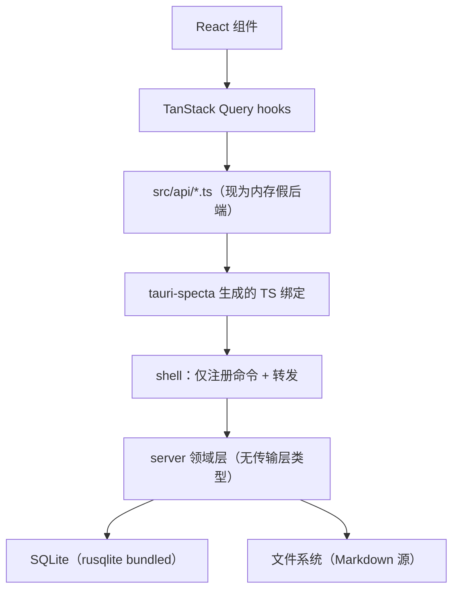

# Lucky-Y 数据库 · 全局架构

**作用**：定义所有模块共用的一套 SQL 约定（分层、命名、判据、迁移）。各模块 / 各簇的设计文档与 DDL 放在自己的子目录下（`work-design/`、`srv-design/`）。

**事实源**（本文与代码冲突时以代码为准）：

| 事实源 | 提供什么 |
| --- | --- |
| `src/types/index.ts` | 枚举与实体字段（`Project` 23 字段、`TaskStatus`、7 值 `DocKind` 等） |
| `src/lib/filter-projects.ts` | 筛选 / 排序 / 计数 —— 索引的唯一依据 |
| `src/data/meta.ts` | 枚举的展示名与颜色（属界面，不入库） |
| `docs/项目表结构设计.md` | 统一执行层的已定稿设计（本文引用其判据） |

---

## 一、分层与职责



- 命令层 `src-tauri/src/lib.rs` 只做创建窗口、注册命令、转发；业务逻辑一律在 `src-tauri/src/server`。
- 领域层不依赖 Tauri 类型，将来可换 HTTP 入口而无需重写。
- 传输用 tauri-specta 生成绑定；前端替换点就是 `src/api/*.ts`（`api/projects.ts` 的文件头已声明"接真实服务时只需替换本文件的实现"）。

---

## 二、三条建表判据

后面每个决定都从这三条推出，不靠手感。

| # | 判据 | 代码里已有的同一条纪律 |
| --- | --- | --- |
| **D1** | 能算出来的不建列 | `daysLeft`、`'3 天后'`、`'12 分钟前'` 全部由时间列派生，不落文案 |
| **D2** | 只落"用户可改、且不由其它列唯一决定"的列 | `progress` 落列（它是里程碑口径，非任务完成率）；`tasksDone/tasksTotal` 派生 |
| **D3** | 中文标签不入库 | `visibility` 存 code，标签与颜色留 `data/meta.ts` |

---

## 三、存储形态三分法

每张表先回答"它属于哪一类"，再决定建不建：

| 类别 | 判据 | 例 | 建法 |
| --- | --- | --- | --- |
| **主存表** | 用户在 UI 里直接编辑，无外部文件源 | `project`、`task`、`work_contact`、`work_okr` | 建表 |
| **外部资源登记表** | 正文在外部工具，本系统只存索引 / 链接 / 脱敏摘要 | `project_document`、`work_doc` | 建表（明确：它**不可由文件重建**） |
| **派生视图** | 不是真实读数、没有写入方 | 工作台聚合、服务器台账 | `VIEW` 或查询时计算，**不建表** |

**推论**：技术选型里的 `notify` 文件监听与 FTS5 只服务于"文件为源"那一类；工作模块的多数实体是主存表，第一轮不引入这两项。

---

## 四、命名与作用域约定

- **模块专属表带模块前缀**：`work_*`。**跨模块共用的统一层不带前缀**（`project`、`task`、`app_user`）。
- **统一层的"某模块视图"用视图表达**：
  ```sql
  CREATE VIEW work_project AS SELECT * FROM project WHERE scope = 'work';
  ```
  禁止把统一层拆成 `work_project` 表 —— 那会退回"一域一张表"，跨域总览要 `UNION`。
- **索引** `ix_<表>_<列...>`；唯一索引 `ux_`。只为真实查询建索引，不建"以后可能用"的。
- **约束**：跨列约束写成一行的 `CHECK`；不建触发器。
- **主键** 一律 `TEXT`，由写入方生成（种子用短 id，新建用 uuid）。本地库需离线创建 + 乐观更新，id 必须先于写库存在。
- **时间** 一律 `TEXT` + ISO-8601（日期 `YYYY-MM-DD`，时刻 `YYYY-MM-DDTHH:MM:SSZ` 存 UTC）。中文长格式、`'N 天前'` 是渲染层的事。
- **枚举** 三处同字面量：SQL `CHECK` / `types/index.ts` / Rust serde。
- **软删** 用状态枚举（`archived`、`closed_at`），不用 `deleted_at` 布尔。

---

## 五、统一执行层：单表 + scope

工作页的项目、项目页的项目、学习区的项目，是**同一张 `project` 表**的不同 `WHERE`：

| 入口 | 路由 | 查询 |
| --- | --- | --- |
| 工作页 | `/work/projects` | `WHERE scope='work'` |
| 生活页 | `/life/projects` | `WHERE scope='life'` |
| 学习区 | `/learning/projects` | `WHERE scope='learn'` |
| 项目页 | `/projects` | `WHERE scope IN (...)`，受权限约束 |

**反模式**（要避开的）：

- 三张表 `project_work / project_life / project_learn`：跨域总览要 `UNION`，口径变三份。
- 按入口建表或用 `is_work_page` 之类布尔 —— "这一页看到哪些"是**查询**，不是数据。
- 关联表不带 `scope`：`join` 会越界（工作机密可能漏进生活 / 学习视图）。
- `scope` 存中文：查不了、索引失效（同 D3）。
- 视图按入口命名（`v_work_project`）：把"三张表"的心智偷渡进视图。

---

## 六、模块 → 表归属

| 模块 | 模块专属表 | 复用统一层 |
| --- | --- | --- |
| 工作 | `work_contact` / `work_doc` / `work_okr` / `work_time_log` / `work_weekly_report` / `work_meeting` | `project` / `task` / `project_milestone` / `project_document` / `project_risk` / `app_user` |
| 生活 | 待设计（`life_*`） | 同上 |
| 学习 | 待设计（`learn_*`） | 同上 |
| 项目 | 无（就是统一层本身） | —— |
| 知识库 | 待设计 | —— |
| 设置 | 待设计（`app_preference` 等） | —— |

规律：**专属表带前缀，共用实体进统一层用 `scope` 隔离**。新增一域时，路径应是"改 CHECK 枚举 + 改 `meta.ts` + 加路由"三处，不动表结构、不动组件。

**跨模块簇**：有些内容不属于任何单一模块，既不进统一层、也不该用某个模块的前缀。这类另立一簇，
当前有 **`srv_*`（服务器台账）** —— 一台机器可服务任意 `scope` 的项目，前缀与模块无关，
详见 `srv-design/服务器台账设计.md`。判据：**这张表的行会不会被第二个模块直接使用？** 会 ⇒ 不进模块前缀。

---

## 七、迁移与版本

- 用 `PRAGMA user_version` 记版本；每个迁移文件末尾写 `PRAGMA user_version = N;`。
- 文件命名 `NNNN_<域>.sql`，按序执行；**已发布的文件禁止改动**，追加新文件。
- 连接建立时必须 `PRAGMA foreign_keys = ON`（SQLite 默认关闭，外键约束不生效）。

---

## 八、不在库里表达的东西

标签、颜色、排序 rank、看板列顺序、各模块的默认视图（生活卡片 / 工作表格 / 学习看板）—— 全部在 `data/meta.ts` 一处定义，按 `scope` 由前端选择。搬进库会让同一张表既存事实又存样式，等于给"改个颜色"加一次迁移。
