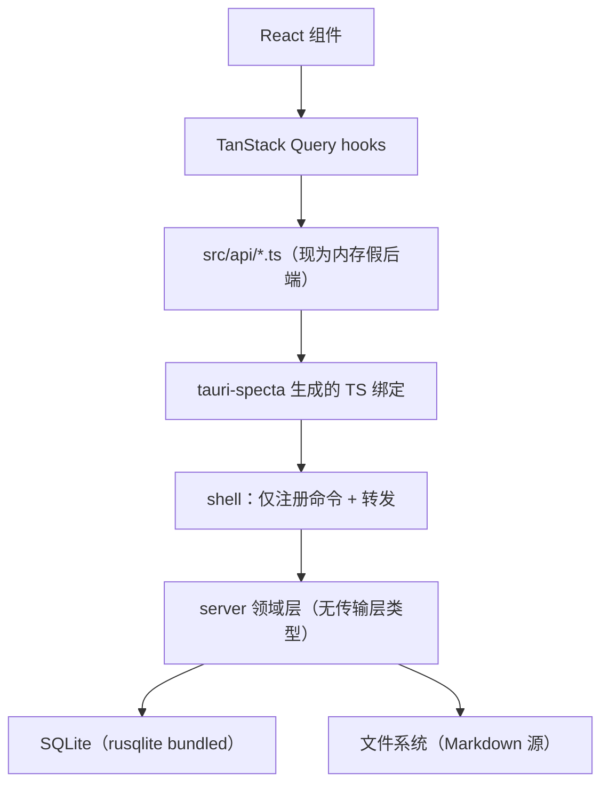

# Lucky-Y 数据库 · 全局架构

**作用**：定义所有模块共用的一套 SQL 约定（分层、命名、判据、迁移）。各模块 / 各簇的设计文档与 DDL 放在自己的子目录下（`work-design/`、`srv-design/`）。

**事实源**（本文与代码冲突时以代码为准）：

| 事实源 | 提供什么 |
| --- | --- |
| `src/types/index.ts` | 枚举与实体字段（`Project` 24 字段、`TaskStatus`、7 值 `DocKind` 等） |
| `src/lib/filter-projects.ts` | 筛选 / 排序 / 计数 —— 索引的唯一依据 |
| `src/data/meta.ts` | 枚举的展示名与颜色（属界面，不入库） |
| `design/sql-design/项目表结构设计.md` | 项目族 + 任务清单的已定稿设计（本文引用其判据） |

---

## 一、分层与职责



- 命令层 `src-tauri/src/lib.rs` 只做创建窗口、注册命令、转发；业务逻辑一律在 `src-tauri/src/server`。
- 领域层不依赖 Tauri 类型，将来可换 HTTP 入口而无需重写。
- 传输用 tauri-specta 生成绑定；前端替换点就是 `src/api/*.ts`（`api/projects.ts` 的文件头已声明"接真实服务时只需替换本文件的实现"）。

---

## 二、三条建表判据

后面每个决定都从这三条推出，不靠手感。

| # | 判据 | 代码里已有的同一条纪律 |
| --- | --- | --- |
| **D1** | 能算出来的不建列 | `daysLeft`、`'3 天后'`、`'12 分钟前'` 全部由时间列派生，不落文案 |
| **D2** | 只落"用户可改、且不由其它列唯一决定"的列 | `progress` 落列（它是里程碑口径，非任务完成率）；`tasksDone/tasksTotal` 派生 |
| **D3** | 中文标签不入库 | `visibility` 存 code，标签与颜色留 `data/meta.ts` |

---

## 三、存储形态三分法

每张表先回答"它属于哪一类"，再决定建不建：

| 类别 | 判据 | 例 | 建法 |
| --- | --- | --- | --- |
| **主存表** | 用户在 UI 里直接编辑，无外部文件源 | `project`、`task`、`work_contact`、`work_okr` | 建表 |
| **文件为源**（正文在本地文件） | 正文是磁盘上的 `.md`，库只存索引 + 文件坐标（`file_path` / `content_hash` / `synced_at`） | `project_document` 中 `source='local_md'` 的那些行 | 建索引表 + 文件落 `<documents 根>/<projectId>/` |
| **外部工具登记表** | 正文在别人的系统里，本系统只存索引 / 链接 / 脱敏摘要 | `work_doc`、`tenant_doc`/`yuque`/`git` 来源的项目文档 | 建表（明确：它**不可由文件重建**，因为正文根本不在这儿） |
| **派生视图** | 不是真实读数、没有写入方 | 工作台聚合、服务器台账 | `VIEW` 或查询时计算，**不建表** |

**推论**：
- `notify`（文件监听）与 FTS5 只服务于"**文件为源**"那一类。项目文档的 `local_md` 已经进了这一类 ⇒
  它们从"第一轮不做"升为"下一步可做"，但**触发条件仍是真实需求**：改动感知先用"打开时比对指纹"（零成本），
  真需要"外部编辑实时反映"再上 `notify`；全文检索等到文档量上去再加（技术选型里那批依赖不撤，只是排序）。
- 同一张表可以横跨两小类（`project_document` 按 `source` 分）：**判据写在行上，不写在表上** ——
  表名说归属，`source` 说这篇东西的正文在哪。

---

## 四、命名与作用域约定

- **模块专属表带模块前缀**：`work_*`。**跨模块共用的统一层不带前缀**（`project`、`task`、`app_user`）。
- **统一层的"某模块视图"用视图表达**：
  ```sql
  CREATE VIEW work_project AS SELECT * FROM project WHERE scope = 'work';
  ```
  禁止把统一层拆成 `work_project` 表 —— 那会退回"一域一张表"，跨域总览要 `UNION`。
- **索引** `ix_<表>_<列...>`；唯一索引 `ux_`。只为真实查询建索引，不建"以后可能用"的。
- **约束**：跨列约束写成一行的 `CHECK`；不建触发器。
- **主键** 一律 `TEXT`，由写入方生成（种子用短 id，新建用 uuid）。本地库需离线创建 + 乐观更新，id 必须先于写库存在。
- **时间** 一律 `TEXT` + ISO-8601（日期 `YYYY-MM-DD`，时刻 `YYYY-MM-DDTHH:MM:SSZ` 存 UTC）。中文长格式、`'N 天前'` 是渲染层的事。
- **枚举** 三处同字面量：SQL `CHECK` / `types/index.ts` / Rust serde。
- **软删** 用状态枚举（`archived`、`closed_at`），不用 `deleted_at` 布尔。

---

## 五、统一执行层：单表 + scope（**功能上归项目模块**）

先说归属，再说存储 —— 这两件事经常被混成一句"公共表"：

- **功能归属**：这套表是**执行层「项目」模块自己的表**（独立分区 `/projects`，侧栏「执行层」分组里只有它）。
  `task` 表属**全局层的「任务清单」**（`/tasks`）—— 它是独立分区，所以任务不必挂在项目上。
- **存储形态**：两者都**跨域共用一张表**，用 `scope` 隔离。生活 / 工作 / 学习三个域的项目页
  *不是各自有一套项目*，而是**引用**同一个项目模块、只换 `WHERE`：

| 入口 | 路由 | 查询 | 归属 |
| --- | --- | --- | --- |
| 生活页 | `/life/projects` | `WHERE scope='life'` | 生活模块**引用**项目模块 |
| 工作页 | `/work/projects` | `WHERE scope='work'` | 工作模块**引用**项目模块 |
| 学习区 | `/learning/projects` | `WHERE scope='learn'` | 学习模块**引用**项目模块 |
| 项目页 | `/projects` | `WHERE scope IN (...)` | **项目模块本身**（跨域总览 / 全部） |

⇒ "工作里的项目"没有第二套表、第二套 API、第二套组件；它只是项目模块在当前域的一次 `scope` 过滤。
  反过来说：改项目表结构时，三个域的入口**同时**受影响 —— 这是有意的。

**反模式**（要避开的）：

- 三张表 `project_work / project_life / project_learn`：跨域总览要 `UNION`，口径变三份。
- 按入口建表或用 `is_work_page` 之类布尔 —— "这一页看到哪些"是**查询**，不是数据。
- 关联表不带 `scope`：`join` 会越界（工作机密可能漏进生活 / 学习视图）。
- `scope` 存中文：查不了、索引失效（同 D3）。
- 视图按入口命名（`v_work_project`）：把"三张表"的心智偷渡进视图。
- 把这些表说成"公共设施"而不给出主人：功能归属（项目模块 / 任务清单）与存储共用是两件事，前者决定谁改它、后者决定它长什么样。

---

## 六、模块 → 表归属

| 模块 | 分区 | 自己的表 | 引用别人的表 |
| --- | --- | --- | --- |
| **项目**（执行层） | `/projects` | `project` / `project_member` / `project_tag` / `project_milestone` / `project_document` / `project_document_link` / `project_risk` / `project_activity` | `app_user` / `tag` |
| **任务清单**（全局层） | `/tasks` | `task` | `project`（挂项目时）/ `app_user` |
| 工作 | `/work` | `work_contact` / `work_doc` / `work_doc_link` / `work_okr` / `work_okr_kr` / `work_time_log` / `work_weekly_report` / `work_meeting` / `work_meeting_attendee` | `project`（`scope='work'`）/ `task` / `app_user` |
| 生活 | `/life` | 待设计（`life_*`） | 同上 |
| 学习 | `/learning` | 待设计（`learn_*`） | 同上 |
| 知识库 / 设置 | `/knowledge` `/settings` | 待设计 | —— |

规律：**专属表带前缀；共用实体进统一层用 `scope` 隔离，且它在功能上属于某一个模块** ——
`project` 族归项目模块、`task` 归任务清单，别把它们说成"无主的公共表"。新增一域时，路径应是
"改 CHECK 枚举 + 改 `meta.ts` + 加路由"三处，不动表结构、不动组件。

**跨模块簇**：有些内容不属于任何单一模块，既不进统一层、也不该用某个模块的前缀。这类另立一簇，
当前有 **`srv_*`（服务器台账）** —— 一台机器可服务任意 `scope` 的项目，前缀与模块无关，
详见 `srv-design/服务器台账设计.md`。判据：**这张表的行会不会被第二个模块直接使用？** 会 ⇒ 不进模块前缀。

**文档类表不在同一个模块里**（三族五张，见 §九）：`project_document` 属项目族、`work_doc` 属工作模块、
`srv_deploy_doc` 属跨模块簇 —— 它们的表名已经各自表了态。

---

## 七、迁移与版本

- 用 `PRAGMA user_version` 记版本；每个迁移文件末尾写 `PRAGMA user_version = N;`。
- 文件命名 `NNNN_<域>.sql`，按序执行；**已发布的文件禁止改动**，追加新文件。
- 连接建立时必须 `PRAGMA foreign_keys = ON`（SQLite 默认关闭，外键约束不生效）。

---

## 八、不在库里表达的东西

标签、颜色、排序 rank、看板列顺序、各模块的默认视图（生活卡片 / 工作表格 / 学习看板）—— 全部在 `data/meta.ts` 一处定义，按 `scope` 由前端选择。搬进库会让同一张表既存事实又存样式，等于给"改个颜色"加一次迁移。

---

## 九、文档类：同形的部分与「不合并」的理由

"文档"是**名字相同**，不是同一类实体。三族五张表，各有各的主实体：

| 族 | 表 | 挂谁 | `kind` 轴 | 来源轴 | 边 |
| --- | --- | --- | --- | --- | --- |
| 项目族（执行层） | `project_document` + `project_document_link` | `project`（NOT NULL） | 7 值：方案/设计/接口/测试/规格/调研/参考 | 4 值：**本地 md（默认）** / 腾讯文档 / 语雀 / Git | 四族目标（task/doc/bug/meeting） |
| 工作模块 | `work_doc` + `work_doc_link` | `project` 可空（跨项目索引） | **同 7 值集合** | 6 值：多公司 wiki/部署/会议纪要 | 只有 doc→doc |
| 跨模块簇 | `srv_deploy_doc` | `project`（挂在机器那一段运维里） | **3 值**：手册/流程/脚本 | 无 | 无 |

`project_document` 里的 `local_md` 是**文件为源**那一类（正文是 `<documents 根>/<projectId>/…md`，
库只存 `file_path` / `content_hash` / `synced_at`，读时比对指纹做被动同步）；其余来源是外部工具登记。
**一表两小类，判据在行上**（见 §三）。

**共性三条纪律**（三族都遵守，各自的设计文档里写，不重复复述）：

1. **库不存正文的长文本**：正文要么在文件里（`local_md`），要么在原工具里（外部登记）—— 库里只有索引、链接、脱敏摘要。
2. **两个轴不合并**：`kind`（它是什么）× `source*`（它存在哪儿）。
3. **反链由查询反向扫出**，不落第二份 —— 只有出边的表，没有 `backlinks` 表。

**为什么不合并成一个文档模块 / 一张 `doc` 表**：

- 主实体不同（项目 / 工作清单 / 机器运维），合并要靠"按行切换外键"——SQLite 做不到
  （`project_document_link.to_id` 已经为这件事退让过一次，那是边，不是主结构）。
- `kind` 轴本来就不同：`srv_deploy_doc` 的 3 值是**部署资产**的性质，与另两族的 7 值不是一套词表；
  硬合就得给每个模块加一个"适用哪套枚举"的字段，等于把差异搬进数据。
- 删除语义不同：项目文档 `ON DELETE CASCADE` 跟着项目走；跨项目索引（`work_doc`）不该跟着某个项目消失。
- 归属判据（§六）要求表有主："都叫文档"是**类型**，不是**归属**——按类型摆目录/表，正是 §二 判据要避开的那件事。

**触发合并的条件**（满足任一条再动，且优先考虑视图 / 投影表，而不是改三族的主结构）：

1. 出现**跨族统一呈现面**（比如知识库要一次搜遍所有文档）⇒ 加一张只读投影表或视图，各族的写入仍归各域。
2. 文档**脱离主实体成为独立资产**（不再依附任何项目 / 机器）⇒ 按跨模块簇另立前缀（照 `srv_*` 的先例）。
3. 同一段读写逻辑在**三处**重复（不是两处）⇒ 才值得抽一个共用的仓储层。
