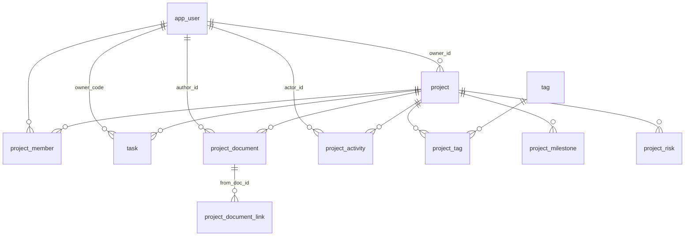

# 项目表结构设计

**归属**（先说归属，再说存储 —— 这两件事经常被混成一句"公共表"）：

| 表族 | 功能归属 | 分区 | 谁引用 |
| --- | --- | --- | --- |
| `project` / `project_member` / `project_tag` / `project_milestone` / `project_document` / `project_document_link` / `project_risk` / `project_activity` | **执行层「项目」模块** | `/projects`（侧栏「执行层」分组里只有它） | 生活 / 工作 / 学习三域按 `scope` 引用 |
| `task` | **全局层「任务清单」** | `/tasks` | 项目详情页的「任务」分区按 `project_id` 引用；各域按 `scope` 过滤 |
| `app_user` / `tag` | 主数据（无模块归属） | —— | 全库 |

**「工作里的项目」不是第二套东西**：`/work/projects` 就是项目模块 + `WHERE scope='work'`
（`/life/projects`、`/learning/projects` 同理）。三个域没有自己的项目表、API、组件 —— 改这里的表结构，
三个入口同时受影响，这是有意的。详见 `全局架构.md` §五。

**范围**：项目族与任务在 SQLite 里的表结构（存储上跨域共用，用 `scope` 隔离）。
引擎与依赖见 `design/architecture-design/技术选型.md`；DDL 全用 SQLite 方言，只有生成列 / 部分索引处标注了版本要求。
**落点**：`work-design/0001_init.sql` —— 本文与那份 DDL 同源，改一处要同时改另一处。

**事实源**（本文与代码冲突时，一律以代码为准）：

| 事实源 | 提供什么 |
| --- | --- |
| `src/types/index.ts` | `Project`（**24** 个字段，含 `path`）、`Task`、`Milestone`、`DocumentItem`、四组枚举 |
| `src/lib/filter-projects.ts` | 筛选 / 排序 / 计数 —— 索引的唯一依据 |
| `src/data/meta.ts` | 枚举的展示名与颜色（**属界面，不入库**） |
| `src/data/derive.ts` | 哪些字段是派生的（`buildTasks` / `buildMilestones` / `buildDocuments` / `buildActivity`） |
| `src-tauri/src/server/project/` · `task/` | 仓储实现（第 1 步开工后以此为准） |

两处文档与代码不一致，本文按代码写：

- `design/architecture-design/模块设计.md` §4 把 scope 写成 `learning`；`types/index.ts` 的 `Scope` 与 DDL 都是 **`learn`（3 值）**。
- 运维四块（服务器 / 发布记录 / 部署文档 / 会议）曾经"不建表"，**已各自落表**：前三者进 `srv_*` 簇（`srv-design/`），会议进 `work_meeting`（`work-design/`）。见 §七。

---

## 一、三条建表判据

后面每个决定都从这三条推出来，不靠手感。

| # | 判据 | 代码里已经存在的同一条纪律 |
| --- | --- | --- |
| **D1** | **能算出来的不建列** | `derive.ts` 的 `docUpdatedText(hours)` / `logUpdatedText(mins)` 把数字算成「3 小时前 / 昨天 / N 天前」，不存文案；`types/index.ts` 的 `DocumentItem` 专门留了 `updatedHours` 而**拒绝**再加 `isNew` 布尔（"那个布尔是 `hours < 24` 的复制品，两个字段迟早会有一个忘了改"） |
| **D2** | **落列的必须是"用户可改、且不由其它列唯一决定"的** | 见 §三 的 `progress` / `tasksDone` 反例 |
| **D3** | **中文标签不入库** | 现在 `visibility` 存 `'家庭可见'`、`Task.due` 存 `'3 天后'`、`document.source` 存 `'腾讯文档'`。一律改存 code，标签与颜色留在 `meta.ts`（界面的事） |

**其它两条全局约定**：

- 时间列一律 `TEXT` + ISO-8601（日期 `YYYY-MM-DD`，时刻 `YYYY-MM-DDTHH:MM:SSZ` 存 UTC）。SQLite 没有日期类型，ISO 串的字典序就是时间序，`date()` / `julianday()` 直接认。**中文长格式是渲染层的事**。
- 主键一律 `TEXT`，由写入方生成（种子用 `p1`…`p8`，新建用 uuid）。不引入自增整数：`shell` 是本地库，离线创建 + 前端乐观更新都需要 id 先于写库存在。

---

## 二、ER 总览



12 张表：`app_user` 是唯一被多方引用的主数据，`project` 是唯一的主表，`task` 是**独立于项目**的（`project_id` 可空 —— 收件箱里的任务还没有项目），其余各自挂 `project_id`。

---

## 三、主表 `project`

```sql
CREATE TABLE project (
  id                TEXT    PRIMARY KEY,
  owner_id          TEXT    NOT NULL REFERENCES app_user(id),
  scope             TEXT    NOT NULL CHECK (scope IN ('life','work','learn')),
  name              TEXT    NOT NULL,
  description       TEXT    NOT NULL DEFAULT '',
  status            TEXT    NOT NULL CHECK (status IN ('planning','active','risk','done','archived')),
  priority          TEXT    NOT NULL CHECK (priority IN ('high','mid','low')),
  progress          INTEGER NOT NULL DEFAULT 0 CHECK (progress BETWEEN 0 AND 100),
  current_milestone TEXT    NOT NULL DEFAULT '',
  start_date        TEXT    NOT NULL,          -- ISO
  due_date          TEXT    NOT NULL,          -- ISO
  budget_cents      INTEGER CHECK (budget_cents IS NULL OR budget_cents >= 0),
  visibility        TEXT    NOT NULL,
  repo_url          TEXT,                      -- NULL = 没有仓库
  docs_ref          TEXT,                      -- 资料的显示名，不是 URL
  path              TEXT,                      -- 本地目录；NULL = 没有目录可指
  sort_order        INTEGER NOT NULL DEFAULT 0,-- 'default' 排序需要一个稳定列
  created_at        TEXT    NOT NULL,
  updated_at        TEXT    NOT NULL,

  -- scope × visibility 的跨列约束：允许集合由域决定，一行写完，不用触发器
  CHECK (
    (scope = 'life'  AND visibility IN ('private','family')) OR
    (scope = 'work'  AND visibility IN ('work_internal','confidential')) OR
    (scope = 'learn' AND visibility IN ('private','public'))
  )
);
```

`status` 是**五态**：`archived` 是软删（归档 / 恢复 / 撤销归档都只是换它，前端不为它另起布尔 —— 见 `api/projects.ts` 的 `setProjectStatus`）。

`sort_order` / `created_at` / `updated_at` / `path` 是**模型里原来没有的列**。理由：`SortMode = 'default'` 在原型与 `data/projects.ts` 里就是"数组给的顺序"，落库后必须有列承载它，否则同一份数据两次查询可能给出不同次序；`created_at/updated_at` 是跨设备同步与冲突判定的最小依据；`path` 是前端表单收「本地目录」（`ProjectPatch.path`，可选 —— 「团队 OKR」这种项目本来没有目录可指）而库里漏掉的那一列。

`scope × visibility` 的 CHECK 在 8 条种子数据上逐条验过：`p1/p2` life+family、`p3/p4` work+work_internal、`p5/p6` learn+private、`p7` learn+public、`p8` life+private —— 全部通过。

### 3.1 字段映射（24 个前端字段 → 列）

| 前端字段 | 列 | 处理 | 依据 |
| --- | --- | --- | --- |
| `id` | `id` | 直存 | — |
| `ownerId` | `owner_id` | FK | 8 条种子恒为 `me` |
| `scope` | `scope` | 直存 | 3 值，见 §五 |
| `name` | `name` | 直存 | — |
| `description` | `description` | 直存 | — |
| `status` | `status` | 直存 | 4 值 |
| `priority` | `priority` | 直存 | 3 值；排序见 §六 ⚠️ |
| `progress` | `progress` | 直存 | 见 3.2 反例 |
| `startDate` | `start_date` | **格式统一** | 现数据 `'2026年06月12日'`，而 `dueDate` 已是 `'2026-10-01'` —— 同一张表里两套日期格式是必须收掉的 |
| `dueDate` | `due_date` | 直存 | 已是 ISO |
| `dueShort` | — | 派生 | `due_date` 的「10月01日」 |
| `dueLong` | — | 派生 | `due_date` 的「2026年10月01日」 |
| `daysLeft` | — | 派生 | 见 3.2 |
| `tasksDone` | — | 派生 | 见 3.2 |
| `tasksTotal` | — | 派生 | 见 3.2 |
| `milestone` | `current_milestone` | **改名** | 见 3.3 |
| `budget` | `budget_cents` | **换算 + 拆空值** | `'¥32,000'` → `3200000`；`'—'` → `NULL` |
| `visibility` | `visibility` | 改存 code | `'家庭可见'` → `'family'`、`'工作内部'` → `'work_internal'` |
| `repoUrl` | `repo_url` | `'—'` → `NULL` | — |
| `docsUrl` | `docs_ref` | **改名 + 拆** | 见 3.3 |
| `path` | `path` | 可选直存 | 没填的项目落 `NULL`（不是空串：前端读它一律"有才显示"） |
| `tags` | `tag` + `project_tag` | 拆表 | `string[]` |
| `owners` | `project_member` | 拆表 | `string[]` |
| `risk` | `project_risk` | 拆表 | 1:N |

合计：**16 个落列**（11 个直存 + 5 个改名/换算）、**5 个派生**、**3 个拆表**。

### 3.2 反例：`progress` 必须落列，`tasksDone/tasksTotal` 必须派生

8 条种子里 6 条满足 `progress == round(tasksDone / tasksTotal × 100)`，两条不满足：

| 项目 | tasksDone / tasksTotal | 算出来 | 实际 `progress` |
| --- | --- | --- | --- |
| `p2` 老房翻新改造 | 9 / 24 | 38% | **42%** |
| `p4` 团队 OKR 落地推进 | 3 / 18 | 17% | **12%** |

⇒ `progress` 是**独立声明**的进度（里程碑口径 / 人给的值），不是任务完成率。落列。

反过来 `daysLeft` 是**快照**：8 条的 `daysLeft` 与 `due_date` 全部等于**相对 `2026-09-18`** 的差值（`p1` `2026-10-01` → 13 天 ✓、`p7` `2026-08-30` → −19 ✓、`p8` `2026-08-15` → −34 ✓）。它一旦落列，第二天就是错的数据 ⇒ 派生（D1）。

`tasksDone/tasksTotal` 同理归 D1：它们的唯一来源是 `task` 表，落成冗余列就是第二份事实源。列表页的读数用一个视图拿，不建列：

```sql
CREATE VIEW v_project_list AS
SELECT p.*,
       (SELECT COUNT(*) FROM task t WHERE t.project_id = p.id) AS tasks_total,
       (SELECT COUNT(*) FROM task t WHERE t.project_id = p.id AND t.state = 'done') AS tasks_done
FROM project p;
```

（"`tasks_done` 恰好等于状态为 `done` 的任务数"这条在本仓成立：`buildTasks` 就是"前 `tasksDone` 个置 `done`"。）

### 3.3 两处改名

- `milestone` → `current_milestone`：它和 `project_milestone` 表**不是同一份东西**。`buildMilestones` 取的是 `POOL[scope].milestones`（life 域是「需求确认 / 方案定稿 / 预订完成 / 行前准备 / 正式启动」），而 `p1` 的 `milestone` 是 `'行程终版确认'` —— 池子里没有这一条。两者同名会让人以为后者是前者的某个切片。
- `docsUrl` → `docs_ref`：8 条数据里这个字段的值是 `'旅行资料库'` / `'技术方案 v3'` / `'OKR 对齐文档'` / `'体检报告索引'` —— **没有一条是 URL**，它们是资料的显示名。叫 `Url` 的名会诱导下一个人往里塞链接，然后前端两种格式都要兼容。

---

## 四、卫星表

### 4.1 `app_user` / `project_member`

```sql
CREATE TABLE app_user (
  id           TEXT PRIMARY KEY,          -- 'me' / 'u_zq'
  code         TEXT NOT NULL UNIQUE,      -- 'LY' / 'WQ' / 'ZQ' / 'HM' —— 头像上那两个字母
  display_name TEXT NOT NULL,             -- '刘阳'
  created_at   TEXT NOT NULL
);

CREATE TABLE project_member (
  project_id TEXT    NOT NULL REFERENCES project(id) ON DELETE CASCADE,
  user_id    TEXT    NOT NULL REFERENCES app_user(id),
  sort_order INTEGER NOT NULL DEFAULT 0,
  PRIMARY KEY (project_id, user_id)
);
```

`display_name` 必须落库且 `NOT NULL`：前端 `derive.ts` 的 `OWNER_NAMES` **只登记了 `LY → 刘阳`**，`p3` 的 `ZQ` / `HM` 现在渲染出来就是字母码。那是名单不全，不是显示逻辑，补全的位置在数据里、不在代码里。

**种子**：`0001_init.sql` 在 `app_user` 建表后直接 `INSERT OR IGNORE` 四个用户（`me/LY/刘阳`、`u_wq/WQ/王琪`、`u_zq/ZQ/张琪`、`u_hm/HM/何敏`）。
没有种子的话，`project_member` 与 `task.owner_code` 的外键会让第一次写入项目成员直接失败 —— 主数据必须先于业务数据存在。
`WQ` 的中文名是按拼音推的，待校准；改它只是一条 `UPDATE`。

### 4.2 `tag` / `project_tag`

```sql
CREATE TABLE tag (
  id   INTEGER PRIMARY KEY,
  name TEXT NOT NULL UNIQUE
);

CREATE TABLE project_tag (
  project_id TEXT    NOT NULL REFERENCES project(id) ON DELETE CASCADE,
  tag_id     INTEGER NOT NULL REFERENCES tag(id)     ON DELETE CASCADE,
  PRIMARY KEY (project_id, tag_id)
);
CREATE INDEX ix_project_tag_tag ON project_tag(tag_id);
```

标签只有 `name` 一列：它是用户随手写的短词（`['旅行','家庭']` / `['重构','客户A']`），没有层级、没有颜色、没有归属域。`projectHit` 把 `tags.join(' ')` 拼进搜索 haystack ⇒ 搜索需要能按 `tag_id` 反查项目，所以补 `ix_project_tag_tag`。

### 4.3 `task`

```sql
CREATE TABLE task (
  id              TEXT    PRIMARY KEY,
  scope           TEXT    NOT NULL CHECK (scope IN ('life','work','learn')),
  project_id      TEXT    REFERENCES project(id) ON DELETE SET NULL,
  owner_code      TEXT    REFERENCES app_user(code),
  title           TEXT    NOT NULL,
  state           TEXT    NOT NULL CHECK (state IN ('todo','doing','blocked','done')),
  priority        TEXT    NOT NULL CHECK (priority IN ('high','mid','low')),
  due_at          TEXT,                                -- ISO；NULL = 没定截止
  scheduled_start TEXT,                                -- 排期落点，时间轴用它定位
  estimate_min    INTEGER CHECK (estimate_min IS NULL OR estimate_min > 0),
  completed_at    TEXT,
  source_kind     TEXT    CHECK (source_kind IS NULL OR source_kind IN ('todo','idea','ref')),
  inbox_at        TEXT,                                -- 进收件箱的时刻，算"停留超过 N 天"
  sort_order      INTEGER NOT NULL DEFAULT 0,
  created_at      TEXT    NOT NULL,
  updated_at      TEXT    NOT NULL,

  -- 有排期就必须有预估时长，否则时间轴算不出块高
  CHECK (scheduled_start IS NULL OR estimate_min IS NOT NULL)
);
```

**它不叫 `project_task`、也不挂死在项目上**：这是一张跨三域共用的任务表（与 `project` 同属统一执行层），"某项目的任务" = `project_id` 指向它的那些行；`project_id` 可空是**事实**——收件箱里还没来得及归项目的任务就该是 NULL，`ON DELETE SET NULL` 保证项目被删时任务回到收件箱而不是消失。

比前端 `Task`（8 个字段的展示态）多出来的列各有出处：

| 列 | 出处 |
| --- | --- |
| `scope` | 三域共用一张表，与 `project.scope` 同步（写入路径保证） |
| `scheduled_start` / `estimate_min` | 任务看板的时间轴档（有排期就要有时长，CHECK 把这条写死） |
| `inbox_at` | "在收件箱停留超过 N 天"的判据 |
| `source_kind` | 任务从哪来（待办 / 想法 / 参考）—— 收件箱的输入分类 |
| `completed_at` | 前端的 `doneDays`（完成日相对今天的天数）由它算 |
| `updated_at` | 跨设备同步与冲突判定的最小依据 |

前端字段的映射：`name` → `title`、`status` → `state`、`owner` → `owner_code`、`due`/`dueDays`/`late` → 由 `due_at` 派生（文案不落库，理由同 D1）、`doneDays` → `completed_at` 派生。

`owner_code` 引用 `app_user.code` 而不是 `id`：前端 `Task.owner` 与 `Project.owners` 现在都是 `'LY'` 这种**码**，保持出参形状不变，前端不用改。

### 4.4 `project_milestone`

```sql
CREATE TABLE project_milestone (
  id         TEXT    PRIMARY KEY,
  project_id TEXT    NOT NULL REFERENCES project(id) ON DELETE CASCADE,
  name       TEXT    NOT NULL,
  state      TEXT    NOT NULL CHECK (state IN ('done','now','todo')),
  due_date   TEXT,                  -- Milestone.date 现在是 '已完成'/'进行中'/'待启动' 文案
  detail     TEXT    NOT NULL DEFAULT '',
  sort_order INTEGER NOT NULL DEFAULT 0
);
CREATE INDEX ix_milestone_project ON project_milestone(project_id, sort_order);

-- 一个项目至多一条「当前阶段」——buildMilestones 恒好只置一条 now
CREATE UNIQUE INDEX ux_milestone_now ON project_milestone(project_id) WHERE state = 'now';
```

部分唯一索引需要 SQLite ≥ 3.8.0（`bundled` 没问题）。它把 `buildMilestones` 里"`i === doneCount` 那一条是 `now`"这条隐含规则写成了数据库约束。

### 4.5 `project_document`

```sql
CREATE TABLE project_document (
  id           TEXT PRIMARY KEY,
  project_id   TEXT NOT NULL REFERENCES project(id) ON DELETE CASCADE,
  name         TEXT NOT NULL,
  module       TEXT NOT NULL DEFAULT '',   -- 筛选栏「模块 → 功能」粗的那层
  func         TEXT NOT NULL DEFAULT '',   -- 细的那层；自由文本，不是枚举
  kind         TEXT NOT NULL CHECK (kind IN ('plan','design','api','test','spec','research','ref')),
  source       TEXT NOT NULL CHECK (source IN ('local_md','tencent_doc','yuque','git')),
  file_path    TEXT,                       -- 相对 documents/ 根；NULL = 无本地正文
  content_hash TEXT,                       -- 正文指纹（FNV-1a 16 位十六进制）
  synced_at    TEXT,                       -- 上次与文件同步的时刻
  summary      TEXT NOT NULL DEFAULT '',
  author_id    TEXT REFERENCES app_user(id),
  updated_at   TEXT NOT NULL,          -- updatedAt / updatedHours / 「是不是新文档」都从它算
  sort_order   INTEGER NOT NULL DEFAULT 0,

  -- local_md 必须有文件坐标；外部登记的那三类则没有
  CHECK (source <> 'local_md' OR file_path IS NOT NULL)
);

-- 文档关联（有向边）。反链由查询反向扫出，不落第二份
CREATE TABLE project_document_link (
  from_doc_id TEXT NOT NULL REFERENCES project_document(id) ON DELETE CASCADE,
  kind        TEXT NOT NULL CHECK (kind IN ('out','risk','meet','bind','ref')),
  to_kind     TEXT NOT NULL CHECK (to_kind IN ('task','doc','bug','meeting')),
  to_id       TEXT NOT NULL,
  PRIMARY KEY (from_doc_id, to_kind, to_id)
);
```

### 正文怎么存：两类，一条分界

**分界看 `source`**，不看"文档"这个名字：

| `source` | 正文在哪 | 库里存什么 | 谁在改它 |
| --- | --- | --- | --- |
| `local_md`（默认） | **本地 `.md` 文件**：`<documents 根>/<projectId>/<文件名>.md` | 索引 + 文件坐标（`file_path` / `content_hash` / `synced_at`） | 应用内编辑，也可用任何外部编辑器直接改文件 |
| `tencent_doc` / `yuque` / `git` | 留在原工具 | 只有索引（+ 链接、脱敏摘要） | 原工具 |

这就是 `技术选型.md` 那句"**Markdown 文件为源、SQLite 为索引**"落到项目文档上的样子 ——
之前它只覆盖"笔记"，现在项目文档的本地那一类也走同一条路。

**写入与同步**（`server/project/doc/`）：

- **写**：`project_doc_write` 写文件 + 更新 `content_hash` / `synced_at`；`project_doc_create` 先落一份（可为空的）正文文件，再登记索引。
- **读**：`project_doc_read` 读文件后比对指纹 —— 对不上说明**正文在外部编辑器被改过**，就地更新索引并回 `changed = true`（界面提一句"这份正文在外部被改过"）。
- **删除**：`project_doc_delete` 删索引与文件（一起走）。
- **被动比对，不引入常驻监听**：`notify` 那套留到确实需要"外部改动实时反映"时再加；打开 / 拉列表时比对已经够用（见 `技术选型.md`）。
- 文件根目在 `config.toml` 的 `[documents] root`（默认工程根 `documents/`），布局 `<root>/<projectId>/<文件名>.md`；文件名由标题折算（保留中英文，其余折成 `-`），同项目重名补 `-2`。

`module` / `func` 是详情页文档分区那套「模块 → 功能」两层筛选的键（`DocLibrary`）。它们与 `kind` 不是一个轴：`kind` 是枚举（7 值、顺序固定），`module/func` 是各域自己的一小组自由文本、顺序按内容池去重保序。所以**不给它们建字典表**。

**关联（边）是一等数据**：`DocLibrary` 渲染"连出去 / 被连到"，所以边必须落表。三个设计点：

- `kind` 与 `to_kind` 一一对应（`out`→task、`risk`→bug、`meet`→meeting、`bind`/`ref`→doc，见 `DocLinkKind` 的注释"不自由组合"），两列都留是为了两个方向都好查；一致性由写入路径保证。
- `to_kind` 四族**一次写全**：目标表还没落的（`bug` 仍在演示池）由写入路径拦住，将来落表不必改 CHECK（SQLite 改 CHECK 要重建表）。
- `to_id` **不挂外键**：它可能指向 `task` / `work_meeting` 这些别的表，SQLite 不能按行切换外键目标。反链靠 `ix_document_link_to` 查。

**"正文不入库"这条红线现在要分开读**：`模块设计.md` 那句「工作文档正文留在公司工具」
说的是 `work_doc`（公司 wiki / 部署 / 会议纪要 —— 那是**保密**要求），**不适用于**项目文档的本地那一类；
但两类都守同一条纪律：**库不存正文的长文本** —— 要么在文件里，要么在原工具里。

#### 与 `work_doc` 的边界（工作模块那份文档索引）

工作模块另有一张 `work_doc` + `work_doc_link`（见 `work-design/工作模块数据库设计.md` §4.2），
两张表不是重复，判据只有一条：

> **这篇文档属于某一个项目吗？**

| | `project_document` | `work_doc` |
| --- | --- | --- |
| 归属 | 项目族（统一层，三域通用） | 工作模块专属 |
| `project_id` | `NOT NULL`（它就是这个项目的文档） | **可空**（跨项目索引：公司 wiki 镜像、会议纪要、外部链接） |
| 分组 | `module` / `func` 两层（筛选栏「模块 → 功能」） | `group_name` 一层（该项目下的哪一类） |
| 来源词表 | 4 值：**本地 md（默认）** / 腾讯文档 / 语雀 / Git | 6 值：多出公司 wiki / 部署 / 会议纪要（公司工具） |
| 呈现面 | 项目详情页「文档」分区（`DocLibrary`，含 links/back 图） | `/work/docs`「文档索引」页（跨项目清单） |
| 后端域 | `server/project/`（本轮已建，文档仓储待第二批接） | `server/work/`（第 3 步） |

两条操作判据，用来挡最常见的两种塞错：

- **不要因为"这个项目是工作项目"就把它的文档塞进 `work_doc`** —— 判据是归属，不是项目的域。
  工作项目里的《支付链路设计》仍是 `project_document`（详情页那一格按 `project_id` 读）。
- **不要因为"这篇文档是工作相关的"就塞进 `work_doc`** —— 同上。反过来，一篇生活旅行清单
  如果收的是公司 wiki 上那种跨项目资料，也不该进 `project_document`（它没有项目可挂）。

将来两边要合并，判据是"文档有没有脱离项目成为独立资产"（那时按跨模块簇另立 `doc_*` 前缀，
照 `srv_*` 的先例），而不是"两张表看着像"。

### 4.6 `project_activity`

```sql
CREATE TABLE project_activity (
  id         TEXT PRIMARY KEY,
  project_id TEXT NOT NULL REFERENCES project(id) ON DELETE CASCADE,
  actor_id   TEXT REFERENCES app_user(id),
  action     TEXT NOT NULL,
  at         TEXT NOT NULL
);
CREATE INDEX ix_activity_project ON project_activity(project_id, at DESC);
```

`ActivityItem.time` 现在是 `ACTIVITY_TIMES = ['12 分钟前','2 小时前','昨天 18:40','3 天前']` 这类展示串 ⇒ 库里存时刻（D1/D3）。

### 4.7 `project_risk`

```sql
CREATE TABLE project_risk (
  id          TEXT PRIMARY KEY,
  project_id  TEXT NOT NULL REFERENCES project(id) ON DELETE CASCADE,
  title       TEXT NOT NULL,
  description TEXT NOT NULL DEFAULT '',
  opened_at   TEXT NOT NULL,
  closed_at   TEXT                       -- NULL = 未关闭
);
CREATE INDEX ix_risk_project ON project_risk(project_id, closed_at, opened_at);
```

类型里 `risk: ProjectRisk | null` 是单值，但建成 **1:N**：单一风险是"当前最该看的那条"这个**视图**，不是表结构。前端那个单值 = 该项目**最早一条未关闭**的风险（`WHERE closed_at IS NULL ORDER BY opened_at LIMIT 1`），出参形状不变。

⚠️ `status = 'risk'` 与"这张表里有没有行"是**两个独立事实**，不允许互相推导：`p3` 状态是 `active` 却带一条风险内容（"鉴权迁移存在兼容风险"），`p2` 状态是 `risk` 也带一条。用 `EXISTS(project_risk)` 去覆写 `status` 会让 `p3` 变成风险阻塞 —— 那是改数据。

---

## 五、枚举

枚举值在**三处必须同字面量**：SQL 的 CHECK、`types/index.ts` 的 TS 字面量、Rust 侧的 serde 定义（`src-tauri/src/server/`，字符串透传不加大小写转换）。

| 枚举 | 取值 | 约束 |
| --- | --- | --- |
| `scope` | `life` / `work` / `learn` | CHECK（**3 值**，不是 `learning`） |
| `status` | `planning` / `active` / `risk` / `done` / `archived` | CHECK（**5 值**）；展示名与排序 rank 在 `meta.ts` |
| `priority` | `high` / `mid` / `low` | CHECK；rank（3/2/1）在 `meta.ts` |
| 任务 `state` | `todo` / `doing` / `blocked` / `done` | CHECK |
| 任务 `source_kind` | `todo` / `idea` / `ref`（可空） | CHECK |
| 里程碑 `state` | `done` / `now` / `todo` | CHECK + 部分唯一索引 |
| `document.kind` | `plan` / `design` / `api` / `test` / `spec` / `research` / `ref` | CHECK |
| `document.source` | `tencent_doc` / `yuque` / `git` / `local_md` | CHECK |
| 文档边 `kind` | `out` / `risk` / `meet` / `bind` / `ref` | CHECK |
| 文档边 `to_kind` | `task` / `doc` / `bug` / `meeting` | CHECK；与 `kind` 一一对应 |
| `visibility` | `private` / `family` / `work_internal` / `confidential` / `public` | 跨列 CHECK（见 §三） |

**不建字典表**：展示名、颜色、排序 rank、看板列顺序（`KANBAN_ORDER`）都是界面的事，已经在 `meta.ts` 一处定义。搬进库里会让同一张表既存事实又存样式，等于给"改个颜色"加一次迁移。

**不落的硬约束**：

- `status = 'done' ⇒ progress = 100`：8 条种子全部满足（`p7`/`p8` 都是 100），但它会禁掉"已完成、进度 90"这种中间态。留在写入路径校验，不写成 CHECK。
- `task.owner_code` 必须是 `project_member` 里的一员：跨表 CHECK 做不到，写入路径校验。

---

## 六、索引（每条对应一条真实查询）

查询全部出自 `lib/filter-projects.ts`（筛选/排序/看紧的）与 `api/projects.ts`（详情页四个分区），没有"先建着"的索引。

```sql
CREATE INDEX ix_project_scope_status    ON project(scope, status);
CREATE INDEX ix_project_scope_due       ON project(scope, due_date);
CREATE INDEX ix_project_scope_progress  ON project(scope, progress DESC);
CREATE INDEX ix_project_owner           ON project(owner_id);
```

| 查询 | 出处 | 走哪条 |
| --- | --- | --- |
| `scope = ? AND status = ?` | `projectHit` 的 status / scope 组 | `ix_project_scope_status` |
| `ORDER BY due_date` | `SortMode='due'`（截止日期最近） | `ix_project_scope_due` |
| `ORDER BY progress DESC` | `SortMode='progress'` | `ix_project_scope_progress` |
| 未完成 + 风险优先 + 逾期次之 + 剩余天数升序，取 3 | `watchProjects` | `ix_project_scope_due` |
| `ORDER BY CASE priority WHEN 'high' THEN 3 WHEN 'mid' THEN 2 ELSE 1 END` | `SortMode='priority'` | **无索引可用**，见 ⚠️ |
| `name/description/current_milestone/tags` 关键词命中 | `projectHit` 的 haystack | 前导通配 `LIKE '%kw%'` 用不上 B-tree；量级 ~10² 直接扫 |
| 详情页任务 / 里程碑 / 文档 / 动态 | `fetchProjectDetail` | 各表的 `(project_id, …)` |
| 按标签找项目 | 标签栏 | `ix_project_tag_tag` |
| 反链：哪些文档连到它 | `DocLibrary` 的「被连到」 | `ix_document_link_to(to_kind, to_id)` |

⚠️ **`ORDER BY priority` 不能写成 `ORDER BY priority DESC`**。枚举的字典序是 `high < low < mid`，业务序是 `high > mid > low` —— 直接按列排序会得到"中 / 低 / 高"这种结果，而且不报错，只是顺序看着不对。必须走 `CASE`（rank 定义在 `meta.ts`，不落生成列：那会给出第二份 rank）。

⚠️ 全文搜索**暂不上 FTS5**。`design/architecture-design/技术选型.md` 已经给笔记全文搜索定了 FTS5 + 中文分词扩展，两处应该共用一套分词配置；现在为了 8 条项目先建一个 `project_fts`，到笔记落地时会出现两套分词设置。数据量到千级以上、或笔记的 FTS5 落地时一起加。

---

## 七、项目详情页其余分区的表归属

项目详情页 7 个分区里，除 `overview` / `tasks` / `docs` 三块直接由本表簇支撑外，其余四块**各有各的家**，都不是项目模块的私有表：

| 分区 | 表 | 在哪 |
| --- | --- | --- |
| 运维（服务器 / 发布记录 / 部署文档） | `srv_server` / `srv_deploy_release` / `srv_deploy_doc` | `srv-design/0003_srv.sql` —— 跨模块簇（一台机器可服务任意 scope 的项目） |
| 会议 | `work_meeting` + `work_meeting_attendee` | `work-design/0002_work.sql` —— 工作模块专属 |
| 账户 | **仍未落表** | 前端 `POOL[scope].accounts` 演示（`work_credential` 之类待设计） |
| 问题清单（Bug） | **仍未落表** | 前端 `POOL[scope].bugs` 演示；文档边 `to_kind='bug'` 已为它留位 |

判据仍是那两条（`derive.ts` 里写的）：`Project` 上没有这些字段，它们不是"项目的属性"；给还没有写入方的块建表，等于把演示池固化成领域模型。

**服务器那一块曾是"没有写入方所以不建表"的典型，现在推翻了** —— 台账页（`/work/servers`）上线后有了真实写入方，于是独立成 `srv_*` 簇。这条演进说明判据是"有没有写入方"，不是"它属于哪个页面"。生活 / 学习域没有运维分区这条，现在由"`srv_server_project` 里没有它的行"决定，不再由池子是否为空决定。

---

## 八、与前端的差额结算

历史结算（迁移前的 `README.md` 待办那条）：前端 `Project` 比后端模型多 11 个必填字段，**接真实数据时会出现「类型说有、运行时没有」且 TS 查不出来**。本文把这 11 个逐条结清：

| 前端多出的字段 | 结算 |
| --- | --- |
| `dueShort` / `dueLong` / `daysLeft` | 派生，不落列（D1） || `tasksDone` / `tasksTotal` | 派生（`v_project_list` 聚合），不落列 |
| `milestone` | 落列，改名 `current_milestone` |
| `budget` | 落 `budget_cents INTEGER NULL`（`'—'` → `NULL`） |
| `visibility` | 落 code + `scope × visibility` 跨列 CHECK |
| `repoUrl` | 落 `repo_url`（`'—'` → `NULL`） |
| `docsUrl` | 落 `docs_ref`（改名；'—' → `NULL`） |
| `risk` | 外移 `project_risk` 表（1:N） |
| `startDate` | 落 `start_date`，格式统一为 ISO |
| `ownerId` | 落 `owner_id`（FK → `app_user`） |
| `path` | 落 `path`（可选，**这条是 2026-10-16 复核时补的** —— 当时结清 23 个字段漏了它，而表单一直在收） |

⇒ 出参形状不需要改：`dueShort/dueLong/daysLeft/tasksDone/tasksTotal` 由后端在查询时算好塞回同一批字段名，前端 `types/index.ts` 一个字段都不用删。

---

## 九、定稿状态与验证

`work-design/0001_init.sql` 是本文的落地形态，`db.rs` 的 `MIGRATIONS` 用 `include_str!` 引它（**编译期契约**：库里没有副本，改本文 = 改那份 DDL，改完要同步另一份）。

2026-10-16 定稿复核（库尚未建过，仍可直接改本文件，不必新开 `0002`）：

| 改动 | 为什么 |
| --- | --- |
| `project` 加 `path TEXT` | 前端 `ProjectPatch.path`（本地目录）在 23 字段结清时漏掉；不落列则写入一次丢一次 |
| `app_user` 加 4 条种子 | `project_member` / `task.owner_code` 的外键要求主数据先存在；名单是数据不是代码 |
| `project_document` 加 `module` / `func` | 详情页文档分区「模块 → 功能」两层筛选的键，前端一直在用 |
| 新增 `project_document_link` | 文档关联（出边）是 `DocLibrary` 的一等功能；反链反向查，不落第二份 |

验证方式（DDL 跑不了 `tsc`，用 sqlite3 起一份临时库逐条验）：

```
.read work-design/0001_init.sql        # 三份 DDL 全部可执行，user_version = 3
.app_user 4 行、29 表 3 视图
反例：owner_id 指向不存在的用户 → FOREIGN KEY constraint failed
反例：life + visibility='work_internal' → CHECK constraint failed
反例：同项目两条 state='now' 的里程碑 → UNIQUE constraint failed
正例：path 读回、文档边写入、反链查询各 1 条
```

⚠️ 注意：sqlite3 CLI 每次连接默认 `foreign_keys = OFF`，验外键要在**同一连接内**先 `.read` 再写；应用侧由 `db::open` 每次显式打开，不依赖默认值。
