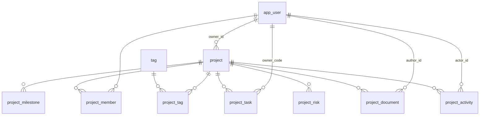

# 项目表结构设计

**范围**：项目（统一执行层，用 `scope` 隔离生活 / 工作 / 学习三域）在 SQLite 里的表结构。
引擎与依赖见 `docs/技术选型.md`（`rusqlite` bundled + `notify` + `pulldown-cmark`）；DDL 全用 SQLite 方言，只有生成列 / 部分索引 / `RETURNING` 处标注了版本要求。

**事实源**（本文与代码冲突时，一律以代码为准）：

| 事实源 | 提供什么 |
| --- | --- |
| `src/types/index.ts` | `Project`（**23** 个字段）、`Task`、`Milestone`、`DocumentItem`、`ActivityItem`、7 值 `DocKind`、四组枚举 |
| `src/data/projects.ts` | 8 条种子数据 —— 目前**唯一**的真实数据 |
| `src/lib/filter-projects.ts` | 筛选 / 排序 / 计数 —— 索引的唯一依据 |
| `src/data/meta.ts` | 枚举的展示名与颜色（**属界面，不入库**） |
| `src/data/derive.ts` | 哪些字段是派生的（`buildTasks` / `buildMilestones` / `buildDocuments` / `buildActivity`） |

两处已知的文档与代码不一致，本文按代码写：

- `docs/模块设计.md` §4 把 scope 写成 `learning`；`types/index.ts` 的 `Scope` 与 Rust `model.rs` 都是 **`learn`（3 值）**。
- `README.md` 说 `Project` 有 22 个字段；按 `types/index.ts` 现文数出来是 **23**（`id` 起 `risk` 止）。

---

## 一、三条建表判据

后面每个决定都从这三条推出来，不靠手感。

| # | 判据 | 代码里已经存在的同一条纪律 |
| --- | --- | --- |
| **D1** | **能算出来的不建列** | `derive.ts` 的 `docUpdatedText(hours)` / `logUpdatedText(mins)` 把数字算成「3 小时前 / 昨天 / N 天前」，不存文案；`types/index.ts` 的 `DocumentItem` 专门留了 `updatedHours` 而**拒绝**再加 `isNew` 布尔（"那个布尔是 `hours < 24` 的复制品，两个字段迟早会有一个忘了改"） |
| **D2** | **落列的必须是"用户可改、且不由其它列唯一决定"的** | 见 §三 的 `progress` / `tasksDone` 反例 |
| **D3** | **中文标签不入库** | 现在 `visibility` 存 `'家庭可见'`、`Task.due` 存 `'3 天后'`、`document.source` 存 `'腾讯文档'`。一律改存 code，标签与颜色留在 `meta.ts`（界面的事） |

**其它两条全局约定**：

- 时间列一律 `TEXT` + ISO-8601（日期 `YYYY-MM-DD`，时刻 `YYYY-MM-DDTHH:MM:SSZ` 存 UTC）。SQLite 没有日期类型，ISO 串的字典序就是时间序，`date()` / `julianday()` 直接认。**中文长格式是渲染层的事**。
- 主键一律 `TEXT`，由写入方生成（种子用 `p1`…`p8`，新建用 uuid）。不引入自增整数：`shell` 是本地库，离线创建 + 前端乐观更新都需要 id 先于写库存在。

---

## 二、ER 总览



10 张表：`app_user` 是唯一被多方引用的主数据，`project` 是唯一的主表，其余 7 张各自挂 `project_id`。

---

## 三、主表 `project`

```sql
CREATE TABLE project (
  id                TEXT    PRIMARY KEY,
  owner_id          TEXT    NOT NULL REFERENCES app_user(id),
  scope             TEXT    NOT NULL CHECK (scope IN ('life','work','learn')),
  name              TEXT    NOT NULL,
  description       TEXT    NOT NULL DEFAULT '',
  status            TEXT    NOT NULL CHECK (status IN ('planning','active','risk','done')),
  priority          TEXT    NOT NULL CHECK (priority IN ('high','mid','low')),
  progress          INTEGER NOT NULL DEFAULT 0 CHECK (progress BETWEEN 0 AND 100),
  current_milestone TEXT    NOT NULL DEFAULT '',
  start_date        TEXT    NOT NULL,          -- ISO;现数据是 '2026年06月12日'
  due_date          TEXT    NOT NULL,          -- ISO;现数据已是 'YYYY-MM-DD'
  budget_cents      INTEGER CHECK (budget_cents IS NULL OR budget_cents >= 0),
  visibility        TEXT    NOT NULL,
  repo_url          TEXT,                      -- NULL = 项目上没有仓库
  docs_ref          TEXT,                      -- NULL = 没有资料;是"资料的显示名",不是 URL
  sort_order        INTEGER NOT NULL DEFAULT 0,-- 新增:SortMode='default' 需要一个稳定列
  created_at        TEXT    NOT NULL,
  updated_at        TEXT    NOT NULL,

  -- scope × visibility 的跨列约束:允许集合由域决定,一行写完,不用触发器
  CHECK (
    (scope = 'life'  AND visibility IN ('private','family')) OR
    (scope = 'work'  AND visibility IN ('work_internal','confidential')) OR
    (scope = 'learn' AND visibility IN ('private','public'))
  )
);
```

`sort_order` / `created_at` / `updated_at` 是**模型里没有的列**。理由：`SortMode = 'default'` 在原型与 `data/projects.ts` 里就是"数组给的顺序"，落库后必须有列承载它，否则同一份数据两次查询可能给出不同次序；`created_at/updated_at` 是跨设备同步（`docs/技术选型.md` 的 Git 同步层）与冲突判定的最小依据。

`scope × visibility` 的 CHECK 在 8 条种子数据上逐条验过：`p1/p2` life+family、`p3/p4` work+work_internal、`p5/p6` learn+private、`p7` learn+public、`p8` life+private —— 全部通过。

### 3.1 字段映射（23 个前端字段 → 列）

| 前端字段 | 列 | 处理 | 依据 |
| --- | --- | --- | --- |
| `id` | `id` | 直存 | — |
| `ownerId` | `owner_id` | FK | 8 条种子恒为 `me` |
| `scope` | `scope` | 直存 | 3 值，见 §五 |
| `name` | `name` | 直存 | — |
| `description` | `description` | 直存 | — |
| `status` | `status` | 直存 | 4 值 |
| `priority` | `priority` | 直存 | 3 值；排序见 §六 ⚠️ |
| `progress` | `progress` | 直存 | 见 3.2 反例 |
| `startDate` | `start_date` | **格式统一** | 现数据 `'2026年06月12日'`，而 `dueDate` 已是 `'2026-10-01'` —— 同一张表里两套日期格式是必须收掉的 |
| `dueDate` | `due_date` | 直存 | 已是 ISO |
| `dueShort` | — | 派生 | `due_date` 的「10月01日」 |
| `dueLong` | — | 派生 | `due_date` 的「2026年10月01日」 |
| `daysLeft` | — | 派生 | 见 3.2 |
| `tasksDone` | — | 派生 | 见 3.2 |
| `tasksTotal` | — | 派生 | 见 3.2 |
| `milestone` | `current_milestone` | **改名** | 见 3.3 |
| `budget` | `budget_cents` | **换算 + 拆空值** | `'¥32,000'` → `3200000`；`'—'` → `NULL` |
| `visibility` | `visibility` | 改存 code | `'家庭可见'` → `'family'`、`'工作内部'` → `'work_internal'` |
| `repoUrl` | `repo_url` | `'—'` → `NULL` | — |
| `docsUrl` | `docs_ref` | **改名 + 拆** | 见 3.3 |
| `tags` | `tag` + `project_tag` | 拆表 | `string[]` |
| `owners` | `project_member` | 拆表 | `string[]` |
| `risk` | `project_risk` | 拆表 | 1:N |

合计：**15 个落列**（10 个直存 + 5 个改名/换算）、**5 个派生**、**3 个拆表**。

### 3.2 反例：`progress` 必须落列，`tasksDone/tasksTotal` 必须派生

8 条种子里 6 条满足 `progress == round(tasksDone / tasksTotal × 100)`，两条不满足：

| 项目 | tasksDone / tasksTotal | 算出来 | 实际 `progress` |
| --- | --- | --- | --- |
| `p2` 老房翻新改造 | 9 / 24 | 38% | **42%** |
| `p4` 团队 OKR 落地推进 | 3 / 18 | 17% | **12%** |

⇒ `progress` 是**独立声明**的进度（里程碑口径 / 人给的值），不是任务完成率。落列。

反过来 `daysLeft` 是**快照**：8 条的 `daysLeft` 与 `due_date` 全部等于**相对 `2026-09-18`** 的差值（`p1` `2026-10-01` → 13 天 ✓、`p7` `2026-08-30` → −19 ✓、`p8` `2026-08-15` → −34 ✓）。它一旦落列，第二天就是错的数据 ⇒ 派生（D1）。

`tasksDone/tasksTotal` 同理归 D1：它们的唯一来源是 `project_task` 表，落成冗余列就是第二份事实源。列表页的读数用一个视图拿，不建列：

```sql
CREATE VIEW v_project_list AS
SELECT p.*,
       (SELECT COUNT(*) FROM project_task t WHERE t.project_id = p.id) AS tasks_total,
       (SELECT COUNT(*) FROM project_task t WHERE t.project_id = p.id AND t.status = 'done') AS tasks_done
FROM project p;
```

（"`tasks_done` 恰好等于状态为 `done` 的任务数"这条在本仓成立：`buildTasks` 就是"前 `tasksDone` 个置 `done`"。）

### 3.3 两处改名

- `milestone` → `current_milestone`：它和 `project_milestone` 表**不是同一份东西**。`buildMilestones` 取的是 `POOL[scope].milestones`（life 域是「需求确认 / 方案定稿 / 预订完成 / 行前准备 / 正式启动」），而 `p1` 的 `milestone` 是 `'行程终版确认'` —— 池子里没有这一条。两者同名会让人以为后者是前者的某个切片。
- `docsUrl` → `docs_ref`：8 条数据里这个字段的值是 `'旅行资料库'` / `'技术方案 v3'` / `'OKR 对齐文档'` / `'体检报告索引'` —— **没有一条是 URL**，它们是资料的显示名。叫 `Url` 的名会诱导下一个人往里塞链接，然后前端两种格式都要兼容。

---

## 四、卫星表

### 4.1 `app_user` / `project_member`

```sql
CREATE TABLE app_user (
  id           TEXT PRIMARY KEY,          -- 'me' / 'u_zq'
  code         TEXT NOT NULL UNIQUE,      -- 'LY' / 'WQ' / 'ZQ' / 'HM' —— 头像上那两个字母
  display_name TEXT NOT NULL,             -- '刘阳'
  created_at   TEXT NOT NULL
);

CREATE TABLE project_member (
  project_id TEXT    NOT NULL REFERENCES project(id) ON DELETE CASCADE,
  user_id    TEXT    NOT NULL REFERENCES app_user(id),
  sort_order INTEGER NOT NULL DEFAULT 0,
  PRIMARY KEY (project_id, user_id)
);
```

`display_name` 必须落库且 `NOT NULL`：前端 `derive.ts` 的 `OWNER_NAMES` **只登记了 `LY → 刘阳`**，`p3` 的 `ZQ` / `HM` 现在渲染出来就是字母码。那是名单不全，不是显示逻辑，补全的位置在数据里、不在代码里。

### 4.2 `tag` / `project_tag`

```sql
CREATE TABLE tag (
  id   INTEGER PRIMARY KEY,
  name TEXT NOT NULL UNIQUE
);

CREATE TABLE project_tag (
  project_id TEXT    NOT NULL REFERENCES project(id) ON DELETE CASCADE,
  tag_id     INTEGER NOT NULL REFERENCES tag(id)     ON DELETE CASCADE,
  PRIMARY KEY (project_id, tag_id)
);
CREATE INDEX ix_project_tag_tag ON project_tag(tag_id);
```

标签只有 `name` 一列：它是用户随手写的短词（`['旅行','家庭']` / `['重构','客户A']`），没有层级、没有颜色、没有归属域。`projectHit` 把 `tags.join(' ')` 拼进搜索 haystack ⇒ 搜索需要能按 `tag_id` 反查项目，所以补 `ix_project_tag_tag`。

### 4.3 `project_task`

```sql
CREATE TABLE project_task (
  id         TEXT    PRIMARY KEY,
  project_id TEXT    NOT NULL REFERENCES project(id) ON DELETE CASCADE,
  name       TEXT    NOT NULL,
  status     TEXT    NOT NULL CHECK (status IN ('todo','doing','blocked','done')),
  priority   TEXT    NOT NULL CHECK (priority IN ('high','mid','low')),
  owner_code TEXT    REFERENCES app_user(code),
  due_date   TEXT,                  -- ISO;NULL = 没定截止
  done_at    TEXT,
  sort_order INTEGER NOT NULL DEFAULT 0
);
CREATE INDEX ix_task_project ON project_task(project_id, status);
```

`Task.due` 现在是**三种文案**：`'3 天后'` / `'已逾期 2 天'` / `'已完成'`（`buildTasks` 里就是 `i % 4 + 1 天后` 这种拼法）。库里存绝对日期，文案与 `late` 都在渲染层算（`late = due_date < date('now') AND status <> 'done'`）—— 理由同 D1：`'3 天后'` 落库第二天就是错的。

`owner_code` 引用 `app_user.code` 而不是 `id`：前端 `Task.owner` 与 `Project.owners` 现在都是 `'LY'` 这种**码**，保持出参形状不变，前端不用改。

### 4.4 `project_milestone`

```sql
CREATE TABLE project_milestone (
  id         TEXT    PRIMARY KEY,
  project_id TEXT    NOT NULL REFERENCES project(id) ON DELETE CASCADE,
  name       TEXT    NOT NULL,
  state      TEXT    NOT NULL CHECK (state IN ('done','now','todo')),
  due_date   TEXT,                  -- Milestone.date 现在是 '已完成'/'进行中'/'待启动' 文案
  detail     TEXT    NOT NULL DEFAULT '',
  sort_order INTEGER NOT NULL DEFAULT 0
);
CREATE INDEX ix_milestone_project ON project_milestone(project_id, sort_order);

-- 一个项目至多一条「当前阶段」——buildMilestones 恒好只置一条 now
CREATE UNIQUE INDEX ux_milestone_now ON project_milestone(project_id) WHERE state = 'now';
```

部分唯一索引需要 SQLite ≥ 3.8.0（`bundled` 没问题）。它把 `buildMilestones` 里"`i === doneCount` 那一条是 `now`"这条隐含规则写成了数据库约束。

### 4.5 `project_document`

```sql
CREATE TABLE project_document (
  id         TEXT PRIMARY KEY,
  project_id TEXT NOT NULL REFERENCES project(id) ON DELETE CASCADE,
  name       TEXT NOT NULL,
  kind       TEXT NOT NULL CHECK (kind IN ('plan','design','api','test','spec','research','ref')),
  source     TEXT NOT NULL CHECK (source IN ('tencent_doc','yuque','git','local_md')),
  summary    TEXT NOT NULL DEFAULT '',
  author_id  TEXT REFERENCES app_user(id),
  updated_at TEXT NOT NULL,          -- updatedAt / updatedHours / 「是不是新文档」都从它算
  sort_order INTEGER NOT NULL DEFAULT 0
);
CREATE INDEX ix_document_project ON project_document(project_id, kind);
```

两个轴都留在表上，谁也不替谁（`types/index.ts` 的原话：`source` = 这篇东西**存在哪儿**，`kind` = 它**是什么**）。`source` 的 4 个 code 对应前端 `DOC_SOURCES = ['腾讯文档','语雀','Git 仓库','本地 Markdown']`。

正文不入库 —— 这是 `docs/模块设计.md` 的红线：只存索引、链接、脱敏摘要，正文留在原工具。

### 4.6 `project_activity`

```sql
CREATE TABLE project_activity (
  id         TEXT PRIMARY KEY,
  project_id TEXT NOT NULL REFERENCES project(id) ON DELETE CASCADE,
  actor_id   TEXT REFERENCES app_user(id),
  action     TEXT NOT NULL,
  at         TEXT NOT NULL
);
CREATE INDEX ix_activity_project ON project_activity(project_id, at DESC);
```

`ActivityItem.time` 现在是 `ACTIVITY_TIMES = ['12 分钟前','2 小时前','昨天 18:40','3 天前']` 这类展示串 ⇒ 库里存时刻（D1/D3）。

### 4.7 `project_risk`

```sql
CREATE TABLE project_risk (
  id          TEXT PRIMARY KEY,
  project_id  TEXT NOT NULL REFERENCES project(id) ON DELETE CASCADE,
  title       TEXT NOT NULL,
  description TEXT NOT NULL DEFAULT '',
  opened_at   TEXT NOT NULL,
  closed_at   TEXT                       -- NULL = 未关闭
);
CREATE INDEX ix_risk_project ON project_risk(project_id, closed_at, opened_at);
```

类型里 `risk: ProjectRisk | null` 是单值，但建成 **1:N**：单一风险是"当前最该看的那条"这个**视图**，不是表结构。前端那个单值 = 该项目**最早一条未关闭**的风险（`WHERE closed_at IS NULL ORDER BY opened_at LIMIT 1`），出参形状不变。

⚠️ `status = 'risk'` 与"这张表里有没有行"是**两个独立事实**，不允许互相推导：`p3` 状态是 `active` 却带一条风险内容（"鉴权迁移存在兼容风险"），`p2` 状态是 `risk` 也带一条。用 `EXISTS(project_risk)` 去覆写 `status` 会让 `p3` 变成风险阻塞 —— 那是改数据。

---

## 五、枚举

枚举值在**三处必须同字面量**：SQL 的 CHECK、`types/index.ts` 的 TS 字面量、Rust `model.rs`（serde lowercase）。

| 枚举 | 取值 | 约束 |
| --- | --- | --- |
| `scope` | `life` / `work` / `learn` | CHECK（**3 值**，不是 `learning`） |
| `status` | `planning` / `active` / `risk` / `done` | CHECK；展示名与排序 rank（0/1/2/3）在 `meta.ts` |
| `priority` | `high` / `mid` / `low` | CHECK；rank（3/2/1）在 `meta.ts` |
| 任务 `status` | `todo` / `doing` / `blocked` / `done` | CHECK |
| 里程碑 `state` | `done` / `now` / `todo` | CHECK + 部分唯一索引 |
| `document.kind` | `plan` / `design` / `api` / `test` / `spec` / `research` / `ref` | CHECK |
| `document.source` | `tencent_doc` / `yuque` / `git` / `local_md` | CHECK |
| `visibility` | `private` / `family` / `work_internal` / `confidential` / `public` | 跨列 CHECK（见 §三） |

**不建字典表**：展示名、颜色、排序 rank、看板列顺序（`KANBAN_ORDER`）都是界面的事，已经在 `meta.ts` 一处定义。搬进库里会让同一张表既存事实又存样式，等于给"改个颜色"加一次迁移。

**不落的硬约束**：

- `status = 'done' ⇒ progress = 100`：8 条种子全部满足（`p7`/`p8` 都是 100），但它会禁掉"已完成、进度 90"这种中间态。留在写入路径校验，不写成 CHECK。
- `project_task.owner_code` 必须是 `project_member` 里的一员：跨表 CHECK 做不到，写入路径校验。

---

## 六、索引（每条对应一条真实查询）

查询全部出自 `lib/filter-projects.ts`（筛选/排序/看紧的）与 `api/projects.ts`（详情页四个分区），没有"先建着"的索引。

```sql
CREATE INDEX ix_project_scope_status    ON project(scope, status);
CREATE INDEX ix_project_scope_due       ON project(scope, due_date);
CREATE INDEX ix_project_scope_progress  ON project(scope, progress DESC);
CREATE INDEX ix_project_owner           ON project(owner_id);
```

| 查询 | 出处 | 走哪条 |
| --- | --- | --- |
| `scope = ? AND status = ?` | `projectHit` 的 status / scope 组 | `ix_project_scope_status` |
| `ORDER BY due_date` | `SortMode='due'`（截止日期最近） | `ix_project_scope_due` |
| `ORDER BY progress DESC` | `SortMode='progress'` | `ix_project_scope_progress` |
| 未完成 + 风险优先 + 逾期次之 + 剩余天数升序，取 3 | `watchProjects` | `ix_project_scope_due` |
| `ORDER BY CASE priority WHEN 'high' THEN 3 WHEN 'mid' THEN 2 ELSE 1 END` | `SortMode='priority'` | **无索引可用**，见 ⚠️ |
| `name/description/current_milestone/tags` 关键词命中 | `projectHit` 的 haystack | 前导通配 `LIKE '%kw%'` 用不上 B-tree；量级 ~10² 直接扫 |
| 详情页任务 / 里程碑 / 文档 / 动态 | `fetchProjectDetail` | 各表的 `(project_id, …)` |
| 按标签找项目 | 标签栏 | `ix_project_tag_tag` |

⚠️ **`ORDER BY priority` 不能写成 `ORDER BY priority DESC`**。枚举的字典序是 `high < low < mid`，业务序是 `high > mid > low` —— 直接按列排序会得到"中 / 低 / 高"这种结果，而且不报错，只是顺序看着不对。必须走 `CASE`（rank 定义在 `meta.ts`，不落生成列：那会给出第二份 rank）。

⚠️ 全文搜索**暂不上 FTS5**。`docs/技术选型.md` 已经给笔记全文搜索定了 FTS5 + 中文分词扩展，两处应该共用一套分词配置；现在为了 8 条项目先建一个 `project_fts`，到笔记落地时会出现两套分词设置。数据量到千级以上、或笔记的 FTS5 落地时一起加。

---

## 七、不落表的六组「运维」内容

项目详情页 7 个分区里的 `ops` / `bugs` / `meetings` / `accounts` 四块，**不建表**：

| 分区 | 现在的来源 | 判定 |
| --- | --- | --- |
| 服务器 / 发布记录 / 部署文档 | `POOL[scope].servers` / `deployNotes` / `deployDocs` → `buildServers` / `buildDeploys` / `buildDeployDocs` | 不建表 |
| 账户 | `POOL[scope].accounts` → `buildAccounts` | 不建表 |
| 问题清单 | `POOL[scope].bugs` → `buildBugs` | 不建表 |
| 会议 | `POOL[scope].meetings` → `buildMeetings` | 不建表 |

判据有两条，都写在 `derive.ts` 里：

1. `Project` 上**没有** bug / server / deploy / meeting / account 这五组字段，这六组是"由项目确定性派生、不是真实读数"。
2. 它们唯一的来源就是演示池，**没有任何写入方**。给它们建表，等于把 demo 池固化成领域模型 —— 之后每个读这张库的人都会以为服务器清单是真实读数。

整块的可见性判据也一并保留在数据里（`POOL[scope].servers` 是否为空：生活 / 学习域为空 ⇒ 这两个域不出现运维分区），不写死成"只有工作项目有运维"。

---

## 八、与前端的差额结算

`README.md` 的待办里那条：前端 `Project` 比后端 `model.rs` 多 11 个必填字段，**接真实数据时会出现「类型说有、运行时没有」且 TS 查不出来**。本文把这 11 个逐条结清：

| 前端多出的字段 | 结算 |
| --- | --- |
| `dueShort` / `dueLong` / `daysLeft` | 派生，不落列（D1） |
| `tasksDone` / `tasksTotal` | 派生（`v_project_list` 聚合），不落列 |
| `milestone` | 落列，改名 `current_milestone` |
| `budget` | 落 `budget_cents INTEGER NULL`（`'—'` → `NULL`） |
| `visibility` | 落 code + `scope × visibility` 跨列 CHECK |
| `repoUrl` | 落 `repo_url`（`'—'` → `NULL`） |
| `docsUrl` | 落 `docs_ref`（改名；'—' → `NULL`） |
| `risk` | 外移 `project_risk` 表（1:N） |
| `startDate` | 落 `start_date`，格式统一为 ISO |
| `ownerId` | 落 `owner_id`（FK → `app_user`） |

⇒ 出参形状不需要改：`dueShort/dueLong/daysLeft/tasksDone/tasksTotal` 由后端在查询时算好塞回同一批字段名，前端 `types/index.ts` 一个字段都不用删。

建表脚本按 `PRAGMA user_version` 做版本号，落 `0001_init.sql`；本文的 DDL 即初版内容。
