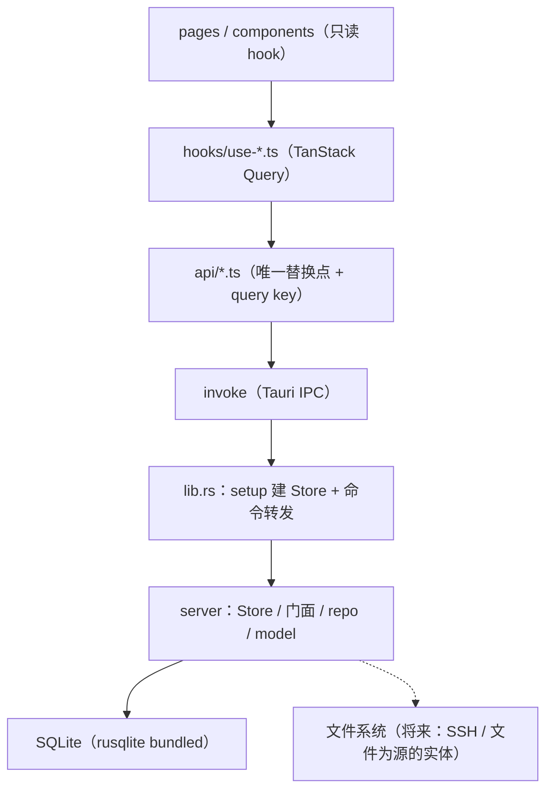

# Lucky-Y 后台架构设计

**作用**：定义桌面端后台的代码分层、目录组织、跨层契约、依赖规则与落地顺序。
表结构归 `design/sql-design/` 管（`全局架构.md` + 各 `*-design/`），本文只管**代码怎么摆、按什么顺序长**。
配图：`后台架构图.html`（分层 / 目录 / 落地顺序）。

**事实源**（本文与代码冲突时以代码为准）：

| 事实源 | 提供什么 |
| --- | --- |
| `src-tauri/src/server/` | 领域层现状：`db.rs` / `error.rs` / `srv/` |
| `src-tauri/src/lib.rs` | 壳层现状：`setup` 建 Store、17 条命令（`greet` + `srv_*` 16 条）、`ApiError` 转错 |
| `src-tauri/Cargo.toml` | crate 边界（path 依赖、feature 开关） |
| `src/api/*.ts` · `src/hooks/use-*.ts` | 前端数据访问层现状 |
| `design/sql-design/全局架构.md` | 三条建表判据、表归属、迁移约定 |

---

## 一、分层与依赖方向



依赖必须单向，四条硬线：

| # | 规则 | 校验方式 |
| --- | --- | --- |
| L1 | `#[tauri::command]` 只写在 `src-tauri/src/lib.rs`，命令体 ≤3 行（取 state / 调领域层 / 转错误） | 命令函数里出现 `if`、`match` 业务分支即违规 |
| L2 | 领域层目录（`src-tauri/src/server/`）不出现 `tauri`、`serde_json::Value` 透传；将来加 HTTP 入口时把目录拆回独立 crate，代码零改动 | `grep -r "use tauri" src-tauri/src/server/` 为 0 |
| L3 | `rusqlite` 只被 `src-tauri/src/server/` 内的文件 import，不外溢到命令层 | `grep -rl "rusqlite" src-tauri/src --include="*.rs" | grep -v "/server/"` 为 0 |
| L4 | 组件不 import `api/*`，只 import `hooks/*`；hook 不直接 `invoke` | `grep -rn "invoke(" src/pages src/components` 为 0 |

领域层是 `src-tauri/src/server/` 目录（Tauri v2 官方布局，单 crate），不是独立 crate：
与命令层的边界从编译期保证降为目录纪律，靠上面 L2 / L3 的 grep 校验兜住。将来加 HTTP
入口时把它剪出成 crate，只多一个 `Cargo.toml`，代码不动。

---

## 二、crate 内部目录组织

现状只有 `srv` 一个域，`Store` 也住在 `srv/mod.rs` 里。加到第二个域就会出现"谁都能改这个大
`impl`、方法名互相撞"的问题，所以先定目录：

```text
src-tauri/src/server/
  mod.rs        模块声明 + 重导出
  store.rs      Store：连接 + 锁
  error.rs      Error / Result（全仓一份）
  db.rs         连接参数（foreign_keys / WAL）+ MIGRATIONS
  common/       统一层：project / task / project_*（跨域共用）
    mod.rs model.rs repo.rs
  srv/          跨模块簇：服务器台账（现有 mod.rs / model.rs / repo.rs）
  work/         工作模块专属：work_contact / work_okr / work_time_log …
```

**判据：目录名 = 表前缀簇名**（`srv` / `work` / `common`）。统一层没有前缀，固定叫 `common`。

### 为什么按域摆，不按职责摆

后端说的「域」= **表的归属簇**（统一层 / 模块专属表 / 跨模块簇三类，见 `design/sql-design/全局架构.md`），
**不等于前端的九域模块**：`srv` 不是任何一个模块的私有表，`common` 也不是一个页面。
前端 `pages/` 按模块摆，后端按「这张表会被谁用」摆 —— 两套划分不同是有意的。

| 摆法 | 得到什么 | 丢掉什么 |
| --- | --- | --- |
| **按域**（`srv/` `work/` `common/`） | 域边界由 Rust 模块系统强制（`pub` 之外的拿不到）；一个功能一次改一个目录；删一个域 = 删一个目录；门面自由函数 `work::list` / `srv::list` 天然不重名 | 横切关注点（错误、id 生成、连接）要靠 crate 根的 `error.rs` / `store.rs` / `db.rs` 收口，重复的只剩 SQL 本身 |
| 按职责（`model/` `repo/` `service/` 平铺） | 改一类关注点只在一个目录 | 一个域的改动横跨三个目录、冲突集中在少数文件；域的封装只剩目录前缀，没有编译期保护，容易越界访问 |

壳层 `shell` **不按域建目录**：一个 `lib.rs` 里按域分段注释，命令平铺注册。
那里没有业务逻辑，分目录只是多一层跳转。

每个域内部固定三段：

| 文件 | 职责 | 边界 |
| --- | --- | --- |
| `model.rs` | 读出形态 `Xxx` + 写入形态 `XxxInput` | 字段名 = 列名转驼峰；`#[serde(rename_all = "camelCase")]` |
| `repo.rs` | 全部 SQL，只收 `&Connection` / `&mut Connection` | 不 import `Store`，不拼展示文案 |
| `mod.rs` | 门面：取锁 + 调 repo + 组装错误 | 唯一的 `pub` 面 |

### 门面形态：自由函数，不是 Store 的方法

```rust
// srv/mod.rs
pub fn list(store: &Store) -> Result<Vec<Server>> { repo::list(&store.conn()?) }
```

`Store` 只留 `open` / `conn()`（`pub(crate)`）/ 锁中毒处理，**不再为每个操作写一个方法**。

三个方案对比，取 B：

| 方案 | 形态 | 取舍 |
| --- | --- | --- |
| A | `impl Store` 写在 `srv/mod.rs`，方法名带前缀 `srv_list` | 保住"唯一入口"，但方法名被迫带前缀，且第二个域照样往同一个类型上加 |
| **B** | 域模块自由函数 `srv::list(&store)` | 模块名就是命名空间，无重名；`conn()` 用 `pub(crate)` 收住封装；壳层调用点是 `server::srv::list(&store)` |
| C | 门面结构体 `srv::SrvRepo<'a>(&'a Store)` | 多一层转发，只为类型系统好看 |

壳层拿到的东西没变：仍然只有业务函数，不知道 SQLite 存在。

---

## 三、领域层契约

### 3.1 事务与锁

现状是**单连接 + `Mutex<Connection>`**，这条保持。规则三条：

- **一次拿锁做完一件事**：写操作从 `validate` 到 `commit` 全在同一把锁内；`get` 回读也在同一把锁内，
  不会读到半个状态（`srv::create` 的 `tx.commit()` 之后直接 `get` 就是这个意思）。
- **锁中毒不吞**：`lock()` 返回 `Error::Invalid("数据库连接已中毒…")`，交给用户重启，不做静默重建。
- **什么时候才需要连接池**：出现单次耗时 >1s 的操作（真的连 SSH、批量导入）时。那类操作**不进 `Store`** ——
  它们属于壳层的异步任务，算完之后再回写一次。SQLite 单写语义下，池子只会把锁竞争换成 `SQLITE_BUSY`。

### 3.2 写入模式

| 场景 | 做法 | 现有例 |
| --- | --- | --- |
| 主表 + 子表（子表 ≤ 几十行） | 子表**整组替换**：`DELETE` 后按 `sort_order` 重插 | `srv::repo::write_children` |
| 子表很大（时间序列） | 行级增量差分 —— **第一轮不做** | `srv_deploy_release`、`work_time_log` 将来要 |
| id | 写入方生成 `TEXT`：`<域>-<nanos hex>-<seq hex>` | `srv::repo::new_id` |
| 时间 | `strftime('%Y-%m-%dT%H:%M:%SZ','now')`，UTC ISO-8601 | 全表 |
| 软删 | 状态列（`removed_at` / `archived` / `closed_at`） | `srv::remove` |
| 硬删 | 只给"填错了"用，其余走软删 | `srv::delete` |

不用自增整数主键：离线创建与乐观更新都要求 **id 先于写库存在**。

分组必须先于从属行写入 —— `srv_server_path` 的 `(server_id, group_name)` 是复合外键，且删分组会级联
删掉它下面的路径。写新域的子表前先看一遍外键方向。

### 3.3 校验：两处同一批规则

`validate()`（领域层，报中文）与 DDL 的 `CHECK` 是**同一批规则的两次书写**，不是"其中一个是防线"。
写入路径先拦，报错才说得上人话；`CHECK` 兜住绕过门面的路径（迁移、手改库）。

### 3.4 错误跨层传递

已落地（2026-10-15）：`Error::code()` 返回 `&'static str`（`db` / `io` / `notFound` / `conflict` /
`invalid`），壳层经 `ApiError` 回可序列化的 `{ code, message }`；TS 侧 `src/api/error.ts` 定义 `ApiError`
（`toString()` 回 `message`，兼容既有 `String(error)` 展示）与 `call()` 包装 —— invoke 的拒绝统一换成
`ApiError`，页面与 hook 拿到的错误永远带 `code`。三处分流（页面按 `code` 分支）是换源时的事：

| 错误 | 界面应有的反应 | 现状 |
| --- | --- | --- |
| `Conflict`（机器名已存在） | 提示 + 聚焦输入框，不关弹窗 | code 已可达，页面未分支 |
| `NotFound`（详情页那台被删了） | 退回列表 + 一条提示 | 同上 |
| `Invalid`（字段不合法） | 定位到那一个字段 | 同上 |

### 3.5 读模型

`hydrate()` 是 N+1（台账一行 → 5 条子表查询）。**几百台以内可接受，先不优化**。
换掉的判据是"单条查询固定开销 × 行数成为主要成本"，那时改一条 `LEFT JOIN` + 内存分组，不改 model。

---

## 四、命令层契约

- **命名 `<域>_<动作>`**，域 = 表前缀簇名：`srv_*` / `work_*` / `project_*` / `task_*`。
  统一层的域名叫 `project` / `task`，不带前缀，与表名一致。
- **参数名与 TS 一致**（`host`、`input`），靠 serde 对齐而不是靠人记。
- **`input` 是整个写模型**，不做字段级补丁 —— 补丁接口会把"哪些字段可改"变成前端的知识。
  唯一的例外是 `srv_update(host, input)`：改动前的机器名是业务键，与内容分开传。
- **业务键优先于主键**：`host` 而非 `id`（路由 `/work/servers/:host` 用的就是它）。新域定命令前先定业务键。
- **注册清单集中在 `generate_handler!`，按域分行**，加域时只加一行。
- 命令不 catch 业务错误、不拼提示语、不做权限判断（本地单用户应用没有权限层）。

---

## 五、前端数据访问层

三个文件各管一段，不要合并：

| 文件 | 管什么 | 不许出现 |
| --- | --- | --- |
| `api/<域>.ts` | `invoke` 调用、TS 类型、query key | 组件状态、React import |
| `hooks/use-<域>.ts` | `useQuery` / `useMutation`、失效策略 | `invoke`、字段拼装 |
| 页面组件 | 只读 hook、渲染 | 直接 `invoke` |

**query key 约定**：`[<域>, 'list']` / `[<域>, 'one', <业务键>]`；写操作统一
`invalidateQueries({ queryKey: [<域>, 'all'] })`。只失效 list 会留下详情页的旧值 —— 改完机器名点进去，
Hero 上还挂着旧名字，这个坑已经踩过。

### 浏览器降级（当前缺口）

`invoke` 只在 Tauri 窗口里可用，浏览器里 `vite dev` 直接抛错 ⇒ 台账页现在只能走错误态。
补一层 `src/lib/env.ts`：`isTauri()` 判定（看 `window.__TAURI_INTERNALS__`），非 Tauri 时 `api/*.ts`
回落演示数据。这样 `vite dev` 仍能看全 UI，而 Tauri 里走的始终是真实路径。

### 演示数据退役顺序

每个域按 **绑定 → 换源 → 删种子** 三步走，删种子的前提是「该域所有读取点都换过」。

现在仍读演示池的位置（清单，换源时逐个消掉）：

| 位置 | 读什么 | 阻塞原因 |
| --- | --- | --- |
| `pages/workspace/LogViewerPage.tsx` | `buildServers(project)` | 日志本身还是前端演示 |
| `pages/workspace/DeployViewerPage.tsx` | `buildServers(project)` | 同上 |
| `components/workspace/project-detail/ProjectDetail.tsx` | `buildServers` / `buildDeployDocs` | 项目详情运维分区 |
| `components/shell/SlotPanel.tsx` | `buildServers(project)` | 工作台侧栏 |
| `components/workspace/work/ServerDetail.tsx` | `buildDeployDocs` | 仓储与命令已就绪（2026-10-15），换源待做 |

`data/meta.ts`（展示名与颜色）与 `data/*/nav.ts`（路由表）**不退役**，它们不是数据源。

---

## 六、数据层

- **迁移**：`PRAGMA user_version`。`db::MIGRATIONS` 用 `include_str!` 直接引 `design/sql-design/` 那三份 DDL，
  **不另存副本**，数组顺序即版本。新增域只加一个 `(N, include_str!(...))`。
- **每次连接**：`PRAGMA foreign_keys = ON`（SQLite 默认关，关了复合外键只是一句注释）+ `journal_mode = WAL`。
- **库文件**：`app_data_dir()/lucky-y.sqlite3`，路径由壳层解析，领域层只收一个 `Path`。
- **绝对路径**：查 / 写应用数据目录一律用 `/Users/<user>/…`，`$HOME` 在沙箱里会指向别处。
- ⚠️ **DDL 改动规则**：迁移按 `user_version` 逐个跳过，**改已跑过的文件不会重跑**。所以：
  - 库刚被移出（10-15 09:13，应用下次启动重建并重跑 `0001`→`0003`）⇒ **现在是改旧 DDL 的窗口**，
    动 `0003_srv.sql` 不必新开 `0004`。
  - 窗口一旦关闭（库已重建过），就只能新增 `0004_*.sql`，或再删一次库。
  文件名 `NNNN_<域>.sql`，全库统一序列，已发布的文件不改。

---

## 七、跨域依赖规则

| 方向 | 允许 | 例 |
| --- | --- | --- |
| 任意域 → 统一层（读） | ✅ | `srv` 的 `hydrate` JOIN `project` 取项目名 |
| 统一层 → 模块专属表 | ❌ | `project` 的查询里不该出现 `work_*` |
| 域 A → 域 B 的 SQL | ❌ | 要改对方数据就调对方门面函数 |
| 域 A → 域 B 的表（读） | ⚠️ 只允许经统一层的 `project` / `task` | 别的都要先在 `design/sql-design/` 里论证归属 |

校验方式：在 `common/` 里 `grep` 各模块前缀应为 0；在 `srv/` 里除了 `project` 之外不应出现别的域的表名。

---

## 八、落地顺序

排序判据两条：**① 先补底座与已有写入方（能立刻被界面用到）；② 修 bug 与补已有表的新增接口，排在开新域之前。**

| 步 | 内容 | 为什么排这里 | 现状 |
| --- | --- | --- | --- |
| 0 | `store.rs` 提出 + 域门面改自由函数 + `Error::code()` | 机械改动、不碰 SQL，越晚做越贵 | ✅ 2026-10-15 |
| 1 | 统一层 `common`：`project` / `task` / `project_*` 仓储 + 命令 + 前端换源 | **所有域的底座**，且这 10 张表现在 0 行、项目仍走前端演示数组 | 未做 |
| 2 | srv 缺口：`host` 唯一性 bug + `srv_deploy_release` / `srv_deploy_doc` 仓储 | 已有界面在等（台账 `deployCount`、KPI「最近发布」、详情页书架） | ✅ 2026-10-15 —— 仓储 / 命令 / api + hooks 绑定就绪；三个读取点的换源待做 |
| 3 | `work` 域：联系人 / OKR / 工时 / 周报 / 会议（9 张表已建） | 界面已存在，纯接线 | 未做 |
| 4 | 生活 / 学习 / 设置域 | 表还没设计 ⇒ **先设计 DDL 再写代码**，不能倒过来 | 未做 |

第 1 步是分水岭：`project` / `task` 落地之前，每个域的"关联项目"都是前端假数据，先接别的域会返工。

---

## 九、第一轮明确不做

`docs/技术选型.md` 里的 `notify` 文件监听、FTS5 全文索引、`tauri-specta` 编译期绑定、`tokio` 异步运行时、
连接池、HTTP 入口、行级增量更新、Git 同步 —— 全部不进第一轮。理由：那几项服务的是"**文件为源**"那一类
实体，而当前实体以主存表为主（`design/sql-design/全局架构.md` §三）。

**唯一的例外**：srv 的日志 / 部署 / 终端三条路由现在全是前端演示。它们要真正执行 SSH 时再引入
`tokio` + 一条独立任务通道 —— 任务不持有 `Connection`，算完把结果交给命令层回写。

---

## 十、已知缺口（挂账）

| # | 缺口 | 影响 | 出路 |
| --- | --- | --- | --- |
| 1 | ~~`host` 是表级 `UNIQUE`，而 `create` 的存在性检查不过滤 `removed_at`~~ | ~~移除后无法用同名重新添加~~ | ✅ 2026-10-15 已修：`create` 命中已移除同名行时复活（保留 id、清 `removed_at`、覆盖字段、子表整组替换）；表级 `UNIQUE` 保留 |
| 2 | `project` / `task` 建了表但没有写入方 | 项目仍走前端演示数组，`vite dev` 与 Tauri 里行为一致但都不落库 | 第 1 步 |
| 3 | `srv_server_project` / `srv_server_port` / `srv_path_group` / `srv_server_path` 只有 API 能写 | 表单没这几项输入 ⇒ 新建机器落「未归属项目」那格 | 补表单，不补仓储 |
| 4 | `srv_deploy_release` / `srv_deploy_doc` 仓储已就绪（2026-10-15），页面未换源 | 台账 `deployCount` 恒 0、KPI「最近发布」停空态、详情页书架读演示池 | 换源：`useReleases` / `useReleaseCounts` / `useDeployDocs` 已备好 |
| 5 | 无 Tauri 环境判定 | 浏览器里台账页只能走错误态 | §五 的 `isTauri()` |
| 6 | ~~命令错误只回文案~~ | ~~前端无法按错误类型分支~~ | ✅ 2026-10-15 已修：壳层 `ApiError {code,message}` + `api/error.ts`（见 §3.4）；页面按 `code` 分支随换源做 |
| 7 | ~~`src/api/servers.ts` 文件头注释过期~~ | ~~误导下一个改动者~~ | ✅ 2026-10-15 已改 |
| 8 | 三仓无提交、无 lint / 测试链 | 无回归防线；本文所有规则只能靠 `tsc --noEmit` + `vite build` 兜 | 不在本轮范围 |
